<div align="center">

<picture>
  <source media="(prefers-color-scheme: dark)" srcset="docs/logo/logo-dark.svg">
  
</picture>

### Is it down, or is it just me?

Real-time status of the IT services we rely on every day: GitHub, Microsoft Azure, Red Hat,<br>
Google Cloud, AWS, Cloudflare and 21 more. Incidents, maintenance and outages in one NOC,<br>
with a world map of failures and a terminal you can type into.

**[uptime.bendi.dev](https://uptime.bendi.dev)**

[](https://github.com/serbenda/uptime/actions/workflows/update-data.yml)
[](https://github.com/serbenda/uptime/actions/workflows/tests.yml)
[](https://github.com/sponsors/serbenda)
<br>


<br>


</div>

<br>

<table>
<tr>
<td width="50%" valign="top">
<a href="#the-outage-map">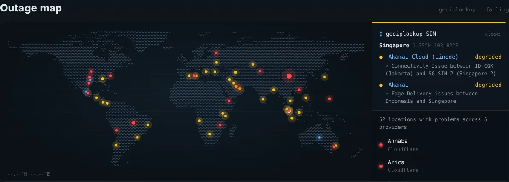</a>
<br><b>A world map made of LEDs.</b> Every failure lights up where it happens, by cloud region, airport code, city or country. Click a dot to see who's failing there and why.
</td>
<td width="50%" valign="top">
<a href="#the-terminal">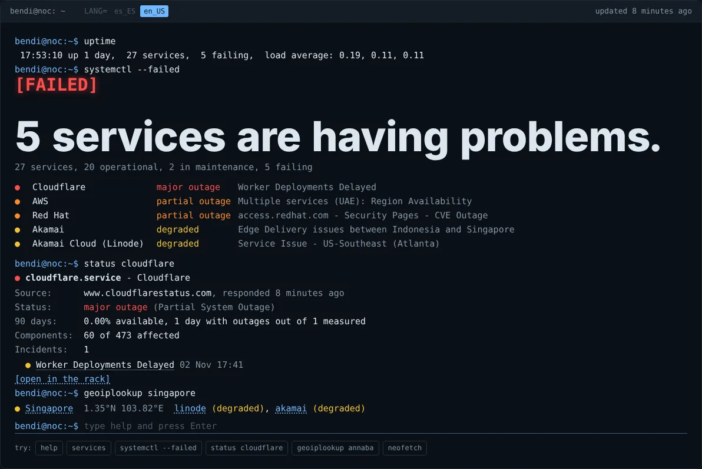</a>
<br><b>A terminal you can type into.</b> <code>status github</code>, <code>systemctl --failed</code>, <code>geoiplookup madrid</code>, <code>top</code>, <code>neofetch</code>… with Tab completion, history and a few easter eggs.
</td>
</tr>
<tr>
<td width="50%" valign="top">
<a href="#racks-and-drawers">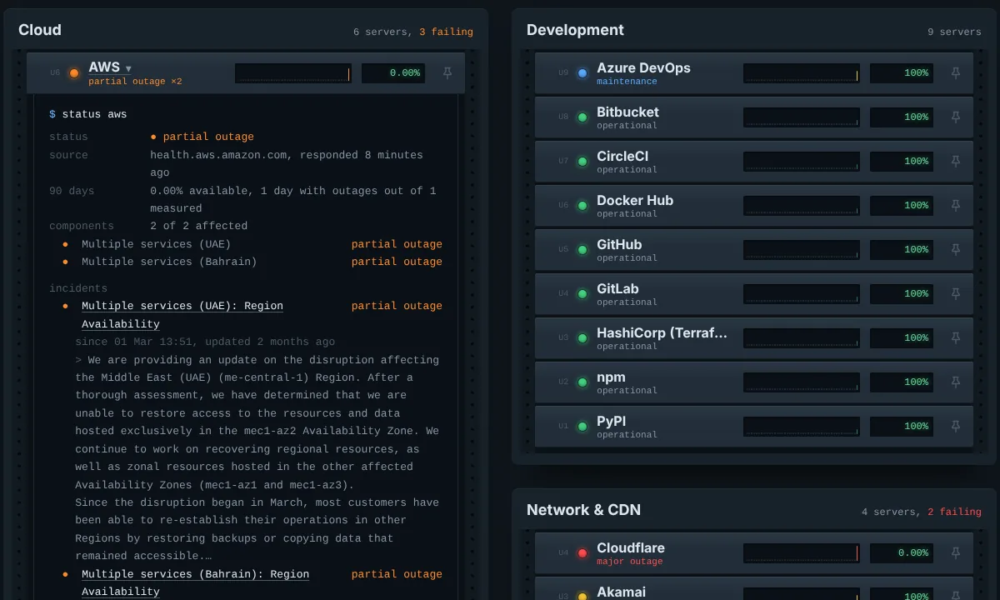</a>
<br><b>One rack per category, one server per provider.</b> A status LED, 90 days of history and an availability display. Pull a server out to read its diagnostics.
</td>
<td width="50%" valign="top">
<a href="#open-incidents">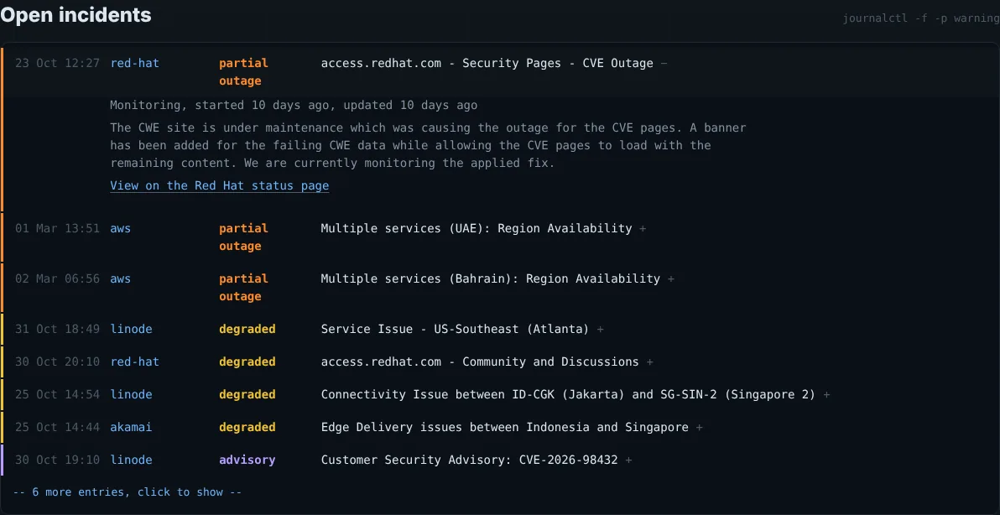</a>
<br><b>Every open incident in one journal.</b> Most severe first, with the provider's latest update and a link to the source. Security advisories never count as outages.
</td>
</tr>
</table>

> [!NOTE]
> uptime **does not probe** services itself: it reads what each provider publishes on its official status page. If a provider is slow to acknowledge a problem, or never reports it, it won't show up here either. Availability figures are an estimate based on those pages. They are nobody's SLA and carry no contractual value.

---

## Contents

1. [In 30 seconds](#in-30-seconds)
2. [A tour of the site](#a-tour-of-the-site)
   - [The console](#the-console) · [The terminal](#the-terminal) · [The outage map](#the-outage-map) · [Open incidents](#open-incidents)
   - [Racks and drawers](#racks-and-drawers) · [Filters, pins and notifications](#filters-pins-and-notifications) · [Maintenance and history](#maintenance-and-history)
   - [The power supply](#the-power-supply) · [Languages](#languages) · [On mobile](#on-mobile) · [Links and shortcuts](#links-and-shortcuts) · [Accessibility](#accessibility)
3. [Terminal reference](#terminal-reference)
4. [Providers](#providers)
5. [How status is decided](#how-status-is-decided)
6. [How availability is calculated](#how-availability-is-calculated)
7. [How failures are placed on the map](#how-failures-are-placed-on-the-map)
8. [Architecture](#architecture)
9. [Operations](#operations)
   - [Workflows](#workflows) · [Triggering the runs](#triggering-the-runs) · [How the Actions fit together](#how-the-actions-fit-together) · [Setting it up](#setting-it-up) · [Troubleshooting](#troubleshooting)
10. [Development](#development)
11. [Data formats](#data-formats)
12. [Security and privacy](#security-and-privacy)
13. [FAQ](#faq)
14. [Known limitations](#known-limitations)
15. [Roadmap](#roadmap)
16. [Credits](#credits)
17. [Support the project](#support-the-project)

---

## In 30 seconds

| Question | Answer |
|---|---|
| **What is it?** | A single page that brings together the status of 28 services almost every tech team depends on: clouds, code forges, package registries, CDNs, collaboration tools and AI. |
| **What is it for?** | Telling at a glance whether the problem is yours or the provider's, where it's failing and since when. |
| **Where does the data come from?** | Each provider's official status page, read every 10 minutes. |
| **What does it cost?** | Nothing. There are no servers: everything runs on GitHub Actions and GitHub Pages, and a free [cron-job.org](https://cron-job.org) job starts the run every 10 minutes. |
| **What does it need?** | Python 3.12 with no dependencies to collect the data, and a framework-free static page to show it. |
| **What does it look like?** | A NOC (*Network Operations Center*): a console with a terminal, a world map made of LEDs, and one rack per category with one server per provider. |
| **Which languages?** | The site is in English and Spanish, following your browser. |
| **Is it related to anything?** | It's a sibling of [atalaya](https://github.com/serbenda/atalaya), a world situation viewer: same philosophy, same conventions. |

---

## A tour of the site

The site imitates a NOC, and the metaphor isn't just decoration: every piece of the room maps to a piece of information.

| In a real NOC | In uptime |
|---|---|
| The on-call operator's terminal | The console at the top, with its command line |
| The big screen with the alarm map | The outage map |
| The system log (`journalctl`) | Open incidents |
| Racks with their servers and LEDs | One rack per category, one server per provider |
| Pulling a server out of the rack to inspect it | The drawer with its diagnostics terminal |
| The scheduled jobs table (`crontab`) | Maintenance |
| The login history (`last`) | The 30-day history |
| The power supply that keeps it all running | The GitHub Sponsors section |

### The console

Above it sits the logo, and it's live: the LED that dots the **i** takes the colour of the worst status right now, green when everything works and red during a major outage. Next to it, the tagline, *Is it down, or is it just me?*

Below it, a terminal session that has already run two commands:

- **`uptime`** prints a line like the real command: time, days of history, number of services, how many are failing and a *load average*. The load average is real: the share of services with a partial or major outage right now, averaged over the last 7 days and over the last 30. Hover over it for an explanation.
- **`systemctl --failed`** (or `systemctl status providers` when all is well) answers the question with systemd's boot marker: a green `[  OK  ] All systems operational.` or a red `[FAILED] GitHub and Azure are having problems.` With more than three services down it's summarised: `5 services are having problems.`
- Below it, the summary (`28 services, 21 operational, 2 in maintenance, 5 failing`) and one line per failing service: LED, name, status and the title of its worst incident. Each name takes you to its server in the rack.

The title bar shows when the data was last updated (`updated 4 minutes ago`). If it's more than 40 minutes old, it turns orange and warns that updates are running late. It also holds the language switcher (`LANG= es_ES en_US`). The favicon and the tab title change colour with the worst status and show the number of failing services: `(5) uptime`.

On first load, the console appears line by line, as if it were being typed. It's the only entrance animation on the page, and it's skipped when the system asks for reduced motion.

### The terminal


Below the verdict there's a real command line. It's a toy shell that answers with the data on the page: you can ask about a service, list the racks, look up where things are failing or switch languages. It all happens in the browser, and nothing you type leaves it.

- **Getting there:** click anywhere on the console, or press `/` from anywhere on the page.
- **If you don't know what to type:** there are clickable suggestions underneath, and they change with what's happening (`status red-hat` if Red Hat is the worst right now, `geoiplookup` with the first place on the map).
- **Like a shell:** Tab completes commands, services, racks and places; ↑ and ↓ browse the history, which is remembered between visits; Ctrl+L clears; Ctrl+C cancels the line; Esc erases it.
- **If you mistype:** `stauts github` answers `bash: stauts: command not found` and suggests `Did you mean "status"?`.

The full command list is in the [terminal reference](#terminal-reference).

### The outage map


A world map made of LEDs (6,852 land dots, one every 1.5°) with a light on wherever something is failing right now.

| What you see | What it means |
|---|---|
| **Colour** | The worst status at that place, across all providers |
| **Size** | How many failures are there (components plus incidents) |
| **Pulse** | Partial and major outages pulse; everything else stays still |
| **Blue dot** | Maintenance in progress, not a failure |

- **Hover** over a dot for a tooltip with the place and the providers failing there.
- **Click it** (or press Enter if you got there with the keyboard), and the right-hand column shows a `$ geoiplookup SIN` with the place, its country, its coordinates and, for each provider, its status and the exact text that put it there (the component `Singapore, Singapore - (SIN)`, the incident `Connectivity Issue between ID-CGK (Jakarta) and SG-SIN-2`…). Each provider links to its server in the rack. Esc or *close* clears the selection.
- **The list on the right** has every place with problems, worst first, and highlights the dot as you hover.
- **Under the list** are the failing providers that couldn't be placed (*No specific location: GitHub, Red Hat*).
- **Bottom left** shows the cursor's coordinates: `40.42°N 3.70°W`.
- **The faint lines** are the equator, the tropics and the Greenwich meridian.

How each dot gets its position is explained in [How failures are placed on the map](#how-failures-are-placed-on-the-map).

### Open incidents


A `journalctl -f -p warning` with every active incident from every provider, most severe first and, at equal severity, most recent first. Each line has the time, provider, severity and title. Click it to expand the phase (*Investigating*, *Identified*, *Monitoring*), when it started and was last updated, what it affects, the provider's latest message (in its original language, usually English) and a link to the incident on the provider's page.

The first 8 are shown, and the rest sit behind `-- 12 more entries, click to show --`.

### Racks and drawers

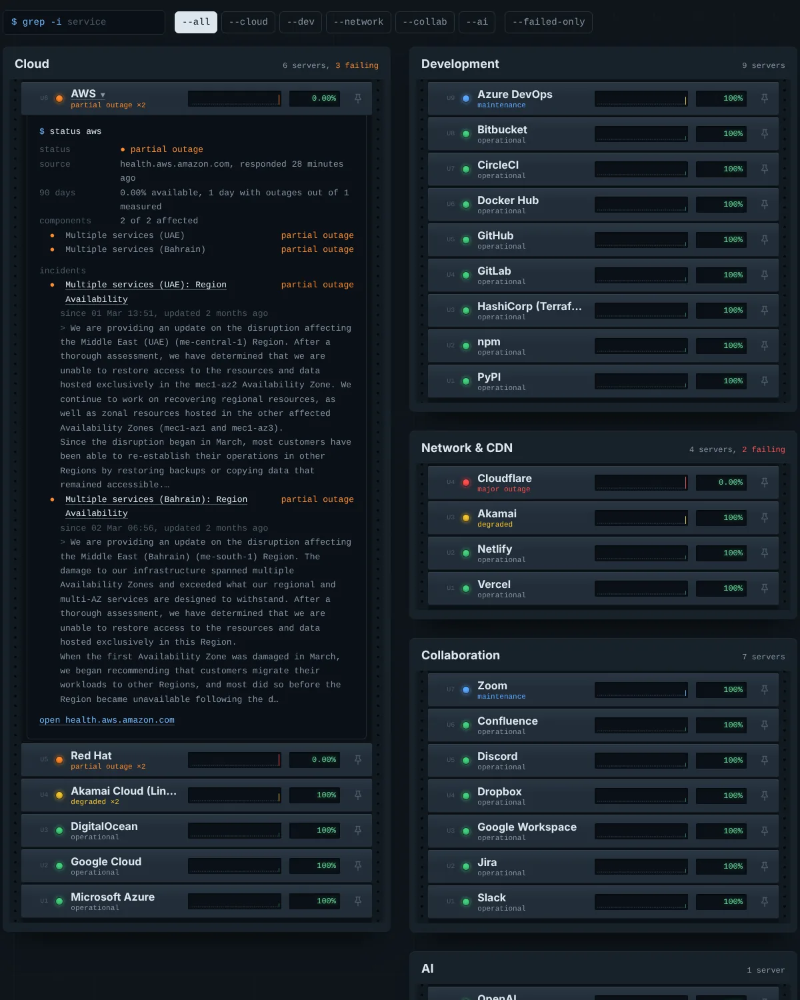

Each category is a rack (with its drilled rails) and each provider a 1U server. Racks sit in two columns with no gaps. Each rack's plate says how many servers it holds and how many are failing.

From left to right, each server has:

| Part | What it tells you |
|---|---|
| **Unit** (`U6`) | Its position in the rack. The worst ones go on top. |
| **LED** | Its status. It blinks fast for partial or major outages and slowly when degraded. |
| **Name and status** | `partial outage ×3` when there are several incidents. |
| **90-day graph** | One bar per day. Height repeats the colour: the worse the day, the taller the bar, so it reads without telling colours apart. Hover a bar for `28 Oct: worst: partial outage (97.2% available)`. |
| **Display** | Availability over the last 90 days, as a green LCD. |
| **Pin** | Keeps it on top (see [Filters, pins and notifications](#filters-pins-and-notifications)). |

**The drawer.** Click a server and it slides out to show its diagnostics terminal, `$ status linode`:

| Line | Content |
|---|---|
| `status` | The status, plus the summary the provider itself publishes (`"Partially Degraded Service"`) |
| `source` | Its status page's domain and when it last responded, or the error if it isn't responding |
| `90 days` | Availability and number of days with outages |
| `components` | How many components it has and how many are affected, with the list (up to 12). If the scope rule was applied, it says so: *small scope: counted as degraded* |
| `incidents` | Each incident with its severity, phase, dates and latest message |
| `maintenance` | Scheduled and in-progress maintenance |
| `open …` | Link to the official status page |

### Filters, pins and notifications

- **`$ grep -i`**: filters services by name as you type.
- **Rack flags**: `--all`, `--cloud`, `--dev`, `--network`, `--collab`, `--ai` (in Spanish, `--todos`, `--nube`, `--desarrollo`, `--red`, `--colaboracion`, `--ia`).
- **`--failed-only`**: keeps only services that are failing, in maintenance or without data.
- **Pins**: each server's pin moves it to a *Pinned* rack that comes first. It's stored in your browser, with no accounts.
- **Notifications**: once you've pinned something, a *Notify me when a pinned one fails* button appears. If you allow it, the browser shows a notification when a pinned service gets worse (degraded or above) and another when it recovers. It only works while the page is open (in a tab, even if not visible): the page reloads its data every 5 minutes and whenever you come back to the tab.

### Maintenance and history

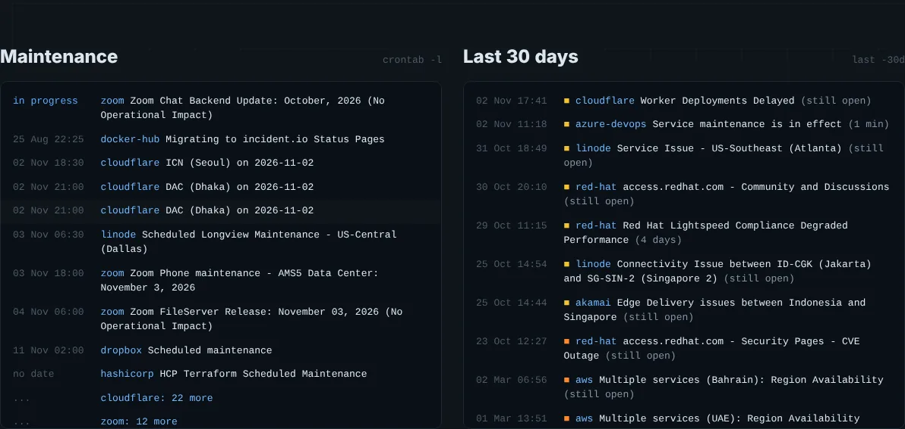

- **Maintenance** (`crontab -l`): in-progress first, then upcoming by date. Up to 3 per provider, because Cloudflare schedules dozens of data centres at once. The rest are summarised as `cloudflare: 24 more`, which opens its drawer.
- **Last 30 days** (`last -30d`): the incidents seen, with their duration (`(3 h 20 min)`) or `(still open)`. The 60 most recent. Security advisories are left out.

### The power supply

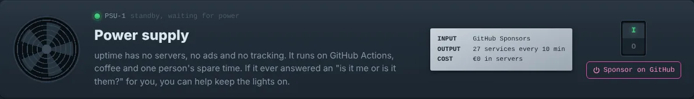

The GitHub Sponsors section is shaped like a server's power supply:

- **The fan** spins slowly, and speeds up when you hover the switch.
- **The PSU LED** is blue on standby (*waiting for power*) and turns green as you approach the switch.
- **The specification label**, like the silver sticker on a real PSU, shows real figures: `INPUT GitHub Sponsors`, `OUTPUT 28 services every 10 min`, `COST €0 in servers`.
- **The I/O rocker switch** is the link to [github.com/sponsors/serbenda](https://github.com/sponsors/serbenda).

### Languages

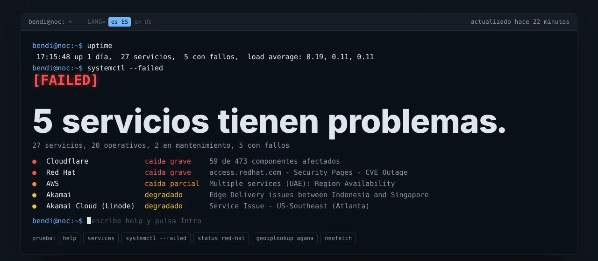

The site speaks English and Spanish. The language is picked in this order:

1. `?lang=en` or `?lang=es` in the address.
2. Your last choice in the console's `LANG=` switcher or with the `lang` command, remembered in the browser.
3. The browser's language: Spanish if any preferred language is `es`, English otherwise.

Switching repaints the whole page without reloading: labels, dates (`02 Nov` / `02 nov`), relative times (`3 minutes ago` / `hace 3 minutos`), place names (`London` / `Londres`), coordinates (`3.70°W` / `3.70°O`), filter flags and the terminal's answers. Text published by providers (incident titles and messages) is shown as is, usually in English, marked with `lang="en"` for screen readers.

### On mobile

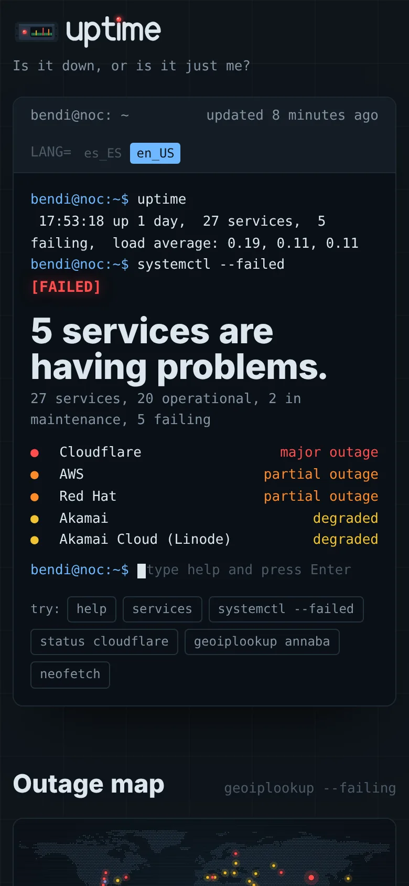

On narrow screens, each server splits into two rows (name, display and pin on top, the 90-day graph underneath), the map takes the full width with its list below, and the power supply rearranges itself. The terminal works with the phone's keyboard, and the clickable suggestions save you from typing.

### Links and shortcuts

| Link | What it opens |
|---|---|
| `#p=github` | The page with GitHub's drawer open and in view |
| `?lang=es` | The page in Spanish (and remembers it) |
| `?local` | Reads data from `data/` instead of the `data` branch (for development) |

| Key | Where | What it does |
|---|---|---|
| `/` | Anywhere outside a text field | Jumps to the terminal |
| `Enter` | Terminal | Runs the command |
| `Tab` | Terminal | Completes commands, services, racks and places |
| `↑` `↓` | Terminal | Command history |
| `Ctrl+L` | Terminal | Clears the output |
| `Ctrl+C` | Terminal | Cancels the line (prints `^C`) |
| `Esc` | Terminal | Erases the line |
| `Esc` | Map | Clears the selected place |
| `Enter` or `Space` | A dot on the map | Selects it |

### Accessibility

- **Keyboard**: everything works without a mouse. Map dots take focus and are selected with Enter; selecting a place doesn't redraw the map, so focus isn't lost; focus is always visible.
- **Screen readers**: the terminal output is a `role="log"` region that announces changes; the list next to the map is a text alternative to the dots; each dot has a label such as *Houston: major outage, 1 provider*; provider text carries `lang="en"`.
- **Colour**: status never depends on colour alone. It always comes with text (*partial outage*), and in the graphs bar height repeats severity.
- **Motion**: with `prefers-reduced-motion` there's no typing console, no blinking LEDs, no pulsing map, no spinning fan and no smooth scrolling.
- **Contrast**: a single dark theme, built for on-call screens, with main text `#DCE6EE` on `#0F151B`.

---

## Terminal reference

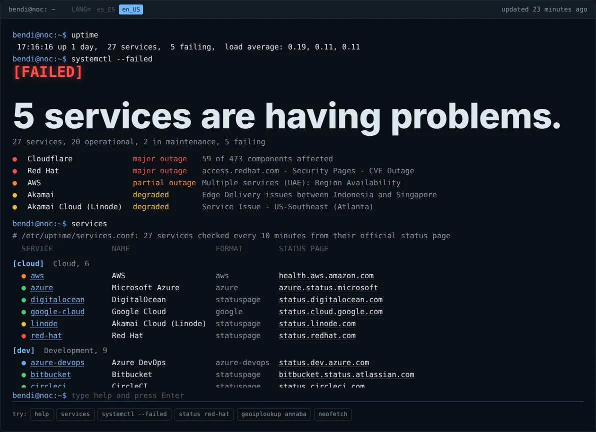

Commands and options are the same in both languages; answers come in the selected language. Services can be named by their id (`google-cloud`), their name (`google cloud`) or any fragment that matches just one (`cloudf`). If several match, the terminal lists them and asks you to be more specific.

### Information

| Command | Aliases | What it does | Example |
|---|---|---|---|
| `help` | `ayuda`, `?` | List of commands with a description of each | `help` |
| `services [rack]` | `servicios`, `svc`, `providers`, `proveedores`, `systemctl list-units`, `cat /etc/uptime/services.conf` | Everything uptime monitors, rack by rack: LED, id, name, status page format and link | `services cloud` |
| `status <service>` | `systemctl status <service>` | A `systemctl status`-style card: source and when it responded, status, 90-day availability, affected components and the first 5 incidents, with a link to its server in the rack | `status cloudflare` |
| `systemctl --failed` | | A `UNIT STATUS DESCRIPTION` table of failing services, worst first | `systemctl --failed` |
| `systemctl status` | | The console's verdict on one line | `systemctl status` |
| `ls [rack]` | `dir` | One line per rack with its servers' LEDs; with a rack, the details | `ls network` |
| `ls -l` | `ll` | Details for every rack: LED, id, status and availability | `ls -l` |
| `journalctl [service]` | `journal` | Open incidents, for all or one, newest first (up to 25) | `journalctl aws` |
| `geoiplookup [place]` | `where` | With no argument, every place with failures; with a place, just that one, and it gets selected on the map | `geoiplookup singapore` |
| `top` | `htop`, `top10` | The 10 services with the worst 90-day availability | `top` |
| `ping <service>` | | When its status page last responded, with its status. It also explains that uptime doesn't ping anyone | `ping github` |
| `crontab -l` | | In-progress and upcoming maintenance (up to 20) | `crontab -l` |
| `last` | | The 15 most recent incidents of the last 30 days, with their duration | `last` |
| `grep <text>` | | Searches service names, incident titles and components, highlighting the match | `grep singapore` |
| `uptime` | | The `uptime` line | `uptime` |
| `neofetch` | `fastfetch` | The NOC at a glance: an ASCII rack with one LED per rack coloured by its worst status, plus services, racks, failures, locations, data age and language | `neofetch` |

### Session

| Command | Aliases | What it does |
|---|---|---|
| `lang en` · `lang es` | `export LANG=es_ES.UTF-8` | Switches the whole page's language |
| `history` | | Numbered list of the commands you've typed (the last 50 are kept) |
| `clear` | `cls`, Ctrl+L | Clears the output. The verdict at the top stays |
| `man <command>` | | Usage and description of a command |
| `echo <text>` | | Prints the text |
| `date` | | Full date and time, in the selected language |
| `whoami` | | `guest` |
| `sponsor` | `donate`, `patrocinar` | How to help keep uptime running, with the link |

### Easter eggs

| Command | Answer |
|---|---|
| `sudo …` | `guest is not in the sudoers file. This incident will be reported.` |
| `rm …` | `rm: cannot remove '/': read-only file system. Nice try.` |
| `exit`, `logout`, `quit`, `salir` | `There's no way out: this is a NOC. Close the tab if you want to leave.` |
| `coffee`, `cafe`, `café`, `brew` | `418 I'm a teapot. Coffee is ordered at the power supply: type sponsor.` |
| `hello`, `hi`, `hola` | A greeting and a hint |

### How it behaves

- Each line is capped at 200 characters. Quotes group words (`grep "region availability"`).
- The output keeps the last 300 lines and scrolls itself; the box has a maximum height so it doesn't push the page around.
- Until the data has loaded, only `help`, `clear`, `lang`, `echo`, `whoami`, `date`, `history` and `man` work.
- The first time it's used, `services` reads `data/providers.json` (the same file the collector uses) to find out each status page's format.
- The "did you mean" suggestion uses Levenshtein distance, and only kicks in for a difference of 2 letters or fewer.
- History is stored in `localStorage` (`uptime.history`). If the browser won't store it, everything still works during the visit.

---

## Providers

28 providers in 5 racks. The list lives in [`data/providers.json`](data/providers.json): adding one that uses a known format is a one-line change.

| Rack | id | Provider | Format | Status page |
|---|---|---|---|---|
| Cloud | `aws` | AWS | `aws` | [health.aws.amazon.com](https://health.aws.amazon.com/health/status) |
| Cloud | `azure` | Microsoft Azure | `azure` | [azure.status.microsoft](https://azure.status.microsoft/en-us/status) |
| Cloud | `google-cloud` | Google Cloud | `google` | [status.cloud.google.com](https://status.cloud.google.com/) |
| Cloud | `red-hat` | Red Hat | `statuspage` | [status.redhat.com](https://status.redhat.com) |
| Cloud | `digitalocean` | DigitalOcean | `statuspage` | [status.digitalocean.com](https://status.digitalocean.com) |
| Cloud | `linode` | Akamai Cloud (Linode) | `statuspage` | [status.linode.com](https://status.linode.com) |
| Development | `github` | GitHub | `statuspage` | [githubstatus.com](https://www.githubstatus.com) |
| Development | `gitlab` | GitLab | `statusio` | [status.gitlab.com](https://status.gitlab.com) |
| Development | `bitbucket` | Bitbucket | `statuspage` | [bitbucket.status.atlassian.com](https://bitbucket.status.atlassian.com) |
| Development | `azure-devops` | Azure DevOps | `azure-devops` | [status.dev.azure.com](https://status.dev.azure.com) |
| Development | `docker-hub` | Docker Hub | `statusio` | [dockerstatus.com](https://www.dockerstatus.com) |
| Development | `hashicorp` | HashiCorp (Terraform) | `statuspage` | [status.hashicorp.com](https://status.hashicorp.com) |
| Development | `npm` | npm | `statuspage` | [status.npmjs.org](https://status.npmjs.org) |
| Development | `pypi` | PyPI | `statuspage` | [status.python.org](https://status.python.org) |
| Development | `circleci` | CircleCI | `statuspage` | [status.circleci.com](https://status.circleci.com) |
| Network & CDN | `cloudflare` | Cloudflare | `statuspage` | [cloudflarestatus.com](https://www.cloudflarestatus.com) |
| Network & CDN | `akamai` | Akamai | `statuspage` | [akamaistatus.com](https://www.akamaistatus.com) |
| Network & CDN | `netlify` | Netlify | `statuspage` | [netlifystatus.com](https://www.netlifystatus.com) |
| Network & CDN | `vercel` | Vercel | `statuspage` | [vercel-status.com](https://www.vercel-status.com) |
| Collaboration | `google-workspace` | Google Workspace | `google` | [google.com/appsstatus](https://www.google.com/appsstatus/dashboard/) |
| Collaboration | `slack` | Slack | `slack` | [slack-status.com](https://slack-status.com) |
| Collaboration | `microsoft-365` | Microsoft 365 (Outlook, Teams, OneDrive…) | `microsoft365` | [status.cloud.microsoft](https://status.cloud.microsoft/) |
| Collaboration | `zoom` | Zoom | `statuspage` | [status.zoom.us](https://status.zoom.us) |
| Collaboration | `jira` | Jira | `statuspage` | [jira-software.status.atlassian.com](https://jira-software.status.atlassian.com) |
| Collaboration | `confluence` | Confluence | `statuspage` | [confluence.status.atlassian.com](https://confluence.status.atlassian.com) |
| Collaboration | `dropbox` | Dropbox | `statuspage` | [status.dropbox.com](https://status.dropbox.com) |
| Collaboration | `discord` | Discord | `statuspage` | [discordstatus.com](https://discordstatus.com) |
| AI | `openai` | OpenAI | `statuspage` | [status.openai.com](https://status.openai.com) |

### Supported formats

Every provider publishes its status in its own way. [`update.py`](scripts/update.py) understands eight formats and translates them all into a common one.

| `type` | What it downloads | What it uses | Used by |
|---|---|---|---|
| `statuspage` | `{url}/api/v2/summary.json` from Atlassian Statuspage | Overall indicator, components (excluding groups), unresolved incidents with their components and latest update, maintenance that isn't completed | 19 providers |
| `statusio` | `api.status.io/1.0/status/{page}` | `status_overall`, components, incidents with their latest message, active and upcoming maintenance | GitLab, Docker Hub |
| `google` | `incidents.json` | Only incidents with no end date that have already started; affected products and locations | Google Cloud, Google Workspace |
| `azure` | Active incidents RSS feed | Every RSS item is an active incident | Microsoft Azure |
| `azure-devops` | `/_apis/status/health` | Overall health, and each service's health per geography | Azure DevOps |
| `aws` | Current public events from the AWS Health Dashboard | Service, region, summary and the latest entry in the event log. AWS serves it as UTF-16 with a BOM, which is handled | AWS |
| `slack` | `slack-status.com/api/v2.0.0/current` | Active incidents with their type, affected services and latest note | Slack |
| `microsoft365` | `status.cloud.microsoft/api/posts/mac` and `…/api/posts/m365Consumer`, the two JSON documents Microsoft's public status page renders; each one falls back to `msit.status.cloud.microsoft` if the main host fails | The admin center post (where Microsoft announces broad outages) and one post per consumer service (Outlook.com, OneDrive, Teams…): `Status`, `Title`, `Message` and dates | Microsoft 365 |

### Why some are missing

- **Quay.io**: its status page is Red Hat's; listing it separately duplicated every incident.
- **Providers without a readable public page** (Salesforce, Meta, Apple Developer…): their pages are rendered in the browser, with no stable API that can be read without credentials.

### Adding a provider

**If it uses a known format**, all it takes is one line in `data/providers.json`:

```json
{"id": "sentry", "name": "Sentry", "category": "dev", "type": "statuspage",
 "url": "https://status.sentry.io", "web": "https://status.sentry.io"}
```

| Field | Required | Purpose |
|---|---|---|
| `id` | Yes | Unique identifier, lowercase with hyphens. It's what you type in the terminal and in `#p=` |
| `name` | Yes | Display name |
| `category` | Yes | One of the racks in `categories`: `cloud`, `dev` (development), `network` (network & CDN), `collab` (collaboration), `ai` |
| `type` | Yes | One of the eight formats |
| `url` | Depends on the format | The page's base URL (Statuspage) or the exact URL to download (all others) |
| `page` | `statusio` only | The page id on status.io |
| `web` | Recommended | The page linked for humans |

To check whether a page runs on Statuspage, open `https://its-domain/api/v2/summary.json`. If it returns JSON with `page`, `status` and `components`, it does.

The tests check that every provider has a known `type`, an existing `category`, a unique `id` and an `https` URL.

**If it uses a new format:**

1. Write `parse_<type>(data, prov)` in `update.py`. It receives the parsed JSON (or raw bytes for non-JSON formats) and returns the [common format](#the-common-provider-format).
2. If the response doesn't look as expected, raise `UnexpectedFormat("what's missing")`: it will be treated as that source being down, without breaking the others.
3. Finish with `r["status"] = final_status(r, indicator, affected, in_progress)`, which applies the shared rules and places failures on the map.
4. Register it in `PARSERS` (with `True` if the response is JSON) and, if its URL is built rather than given, in `url_for()`.
5. Add a test class with a sample response: the normal case, an incident and a broken format.

---

## How status is decided

### The scale

| Status | LED | Meaning | Counts against availability? |
|---|---|---|---|
| Operational | 🟢 green | No incidents | No |
| Maintenance | 🔵 blue | Scheduled work in progress | No |
| Degraded | 🟡 yellow | Works, but slow or with occasional errors | No |
| Partial outage | 🟠 orange | Part of the service doesn't work | Yes |
| Major outage | 🔴 red | The service doesn't work | Yes |
| No data | ⚪ grey | The status page isn't responding, or never has | Not counted |
| Advisory | 🟣 violet | Incidents only: informational notices with no impact, such as security advisories | No |

### The rules

A provider's status is **the worst** of four things: its overall indicator, its components, its incidents and its in-progress maintenance. Some providers are slow to move their overall indicator when a component is already down, or keep an incident open while the indicator stays green.

On top of that, three corrections apply:

1. **Scope matters.** If a provider has 20 or more components, fewer than 5% are affected and there's no partial or major incident, its status is capped at *degraded*. That's the case for Cloudflare, which has hundreds of data centres and almost always has a few rerouted: three cities down out of 473 isn't a Cloudflare outage. The drawer says so, and on the map those cities still show their real colour.
2. **Advisories aren't outages.** An incident published with no impact (Statuspage `impact: none`), or whose title is a security notice (`Security Advisory`, `Security Bulletin`, `CVE-2026-…`), is marked as an *advisory*: it's shown, but it doesn't change the status, doesn't go on the map and isn't kept in the history. Akamai and Linode publish their CVE notices this way.
3. **Maintenance isn't a failure.** Azure DevOps reports maintenance as *advisory*; if its message mentions *maintenance*, it counts as maintenance.

### How each format maps

<details>
<summary><b>How each format maps to the scale (table)</b></summary>

| Format | Original value | Status |
|---|---|---|
| Statuspage, component | `operational` · `degraded_performance` · `partial_outage` · `major_outage` · `under_maintenance` | operational · degraded · partial · major · maintenance |
| Statuspage, indicator | `none` · `minor` · `major` · `critical` · `maintenance` | operational · degraded · partial · major · maintenance |
| Statuspage, incident | `none` · `minor` · `major` · `critical` | advisory · degraded · partial · major |
| status.io | `100` · `200` · `300` · `400` · `500` · `600` | operational · maintenance · degraded · partial · major · major |
| Google | `SERVICE_INFORMATION` · `SERVICE_DISRUPTION` · `SERVICE_OUTAGE` | degraded · partial · major |
| Azure (RSS) | any RSS item | partial |
| Azure DevOps | `healthy` · `advisory` · `degraded` · `unhealthy` | operational · degraded · partial · major |
| AWS | any event; *informational* in the title | partial; degraded |
| Slack | `notice` · `incident` · `outage` · `maintenance` | degraded · partial · major · maintenance |
| Microsoft 365 | `Available` · `Operational` · `Service restored` | operational |
| Microsoft 365 | `Service degradation` or any other state | degraded; partial if the text says users are *unable*, or of an *outage*, *failures*…; major if the admin center says so about *multiple* or *all* services |

</details>

Statuspage phases are normalised too, and the Spanish site translates them: *Investigating*, *Identified*, *Monitoring*, *Resolved*, *Postmortem*, *Scheduled*, *In progress*, *Verifying*, *Completed*.

### When a source fails

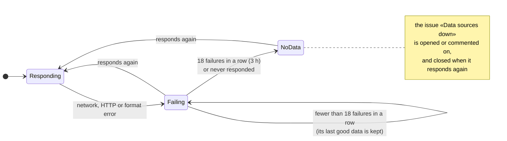

- A provider that doesn't respond **doesn't break the others**: each one is fetched separately, and any error ends up on its own card.
- While it's failing, **its last good data is kept**, and the drawer says so: *not responding (HTTP 503), last data 40 minutes ago*.
- After **18 runs in a row** with no response (3 hours), or if it has never responded, it becomes *No data*.
- Each download has a **20-second** limit and **2 retries** (after 2 and 4 seconds), except for HTTP 4xx errors other than 429, which aren't retried.
- If **no source responds at all**, it's almost certainly the runner's network: the Action fails without publishing.

---

## How availability is calculated

Each run (every 10 minutes) is a **sample**. For each provider and UTC day, three numbers are stored:

| Field | What it counts |
|---|---|
| `samples` | Samples taken that day |
| `down` | Samples where the provider was in a partial or major outage |
| `worst` | The worst status of the day |

- **Availability** over a period = 1 − Σdown / Σsamples. Degraded and maintenance don't count against it.
- Samples where a provider had *no data*, or where its source failed on that run, **don't count**, either way.
- The **90-day graph** draws one bar per day with the colour and height of `worst`; days with no samples appear as short grey bars.
- The **display percentage** uses every sample from the last 90 days; 99.995% or more is shown as `100%`.
- The console's **load average** is: services with an outage now / total, and the share of provider-days with an outage over the last 7 and 30 days.
- The history is trimmed to 90 days on every run.

One consequence worth knowing: with few samples, the percentage is very sensitive. A provider that has spent its first full day with an open partial outage shows `0.00%`, even if the outage only affects one region (as with AWS in its Middle East regions). Over the days, the number settles.

---

## How failures are placed on the map

Status pages carry no coordinates, but they do carry place names. `update.py` looks for places in the **name of every affected component** (all of them, not just the 12 that are stored), in the **title of every incident** and, where the format provides them, in the **incident's components** (Statuspage), its **affected locations** (Google) and its **region** (AWS). Advisories are never placed.

### Search order

| Level | How it's recognised | Example | Result |
|---|---|---|---|
| 1. Cloud region | AWS, Google Cloud and Azure region ids and names, case-insensitive; longer names first (`East US 2` before `East US`) | `Elevated errors in us-east-1`, `Belgium (europe-west1)`, `West Europe` | Ashburn, Brussels, Amsterdam |
| 2. IATA code | Only in three shapes, to avoid matching other acronyms: `(IAH)`, `AMS (…)` at the start, or `XX-YYY` | `Houston, United States - (IAH)` (Cloudflare), `SG-SIN-2` (Linode), `HNL (Honolulu) on …` | Houston, Singapore, Honolulu |
| 3. City | Full capitalised name, in English or Spanish, plus aliases (`Bengaluru`, `N. Virginia`, `Ohio`, `Oregon`…) | `Performance Degradation in Mumbai and Chennai` | Mumbai and Chennai |
| 4. Country | ISO 3166 names in English and Spanish, plus aliases (`US`, `UK`, `UAE`, `Korea`…) | `Core services (Australia)` | The centre of Australia |
| 5. Zone | `Europe`, `EU`, `APAC`, `Middle East`, `LATAM`, `EMEA`… | `Degraded performance in APAC` | A representative point for the zone |

Regions, codes and cities **add up**. Countries are only added when there isn't already a city in that same country: `Houston, United States - (IAH)` gives just Houston, while `Edge Delivery issues between Indonesia and Singapore` gives Singapore and Indonesia. Zones are only used when nothing more specific was found.

For each place, uptime stores its **worst level**, how many failures are there (`n`) and **up to 4 examples** of the text that placed it, which are the ones shown on the map. Each provider has at most **80 points**. Anything that can't be placed is counted in `unlocated`, and the site shows it as *no specific location*.

### The gazetteer

[`data/geo/places_base.json`](data/geo/places_base.json) is maintained by hand:

<details>
<summary><b>What the gazetteer contains</b></summary>

| Section | Content |
|---|---|
| `cities` | 243 cities with data centres or points of presence: `[IATA, English name, Spanish name, ISO-2 country, lat, lon]`. A trailing `"-"` marks ambiguous names (`Córdoba`, `San José`, `Salvador`), which are only matched by their code |
| `city_aliases` | Other names that lead to a city: `Bengaluru`, `Sao Paulo`, `N. Virginia`, `Silicon Valley`, `Iowa`… |
| `regions` | 143 AWS, Google Cloud and Azure region ids and names, each mapped to the nearest city |
| `zones` and `zone_aliases` | 11 world zones with a representative point, and 17 ways of naming them |
| `country_aliases` | Short forms of country names |
| `extra_countries` | Small countries the map doesn't draw (Singapore, Bahrain, Hong Kong, Luxembourg, Malta…) with their coordinates |

</details>

[`scripts/build_map.py`](scripts/build_map.py) merges it with the borders (`world.geojson`) and the country names (`countries.json`) and generates two files that are committed to the repository:

- **`data/places.json`** (about 65 KB): the compiled gazetteer the collector uses. Cities are prefixed with `@` (`@FRA` is Frankfurt) so they don't clash with ISO country codes (`FRA` is France); zones are prefixed with `Z:`. Each country gets a centroid, taken from its largest polygon (its mainland).
- **`data/map.json`** (about 6 KB): the world map as an LED matrix. See [its format](#datamapjson).

If a failure is in a city that isn't listed, it's placed at the centre of its country. To add a city or a region:

```bash
# 1. Edit data/geo/places_base.json
# 2. Regenerate
python3 scripts/build_map.py
# map: 93×240, 6852 land dots
# places: 441 (243 cities, 143 regions, 505 country names)
# 3. Check
python3 -m unittest discover -s tests
```

### The projection

Equirectangular, from 82° N to 56° S, cropping the poles (no data centres, and they take up a lot of room). Each row is a parallel every 1.5°, and odd rows are shifted half a dot so the grid is staggered, like an LED panel. In the browser, a place's coordinates map to the grid with `x = (lon + 180) / 1.5` and `y = (82 − lat) / 1.5`. All the land is drawn as a single SVG `<path>` with one zero-length segment per dot and round caps: thousands of dots in one element.

---

## Architecture

### Overview

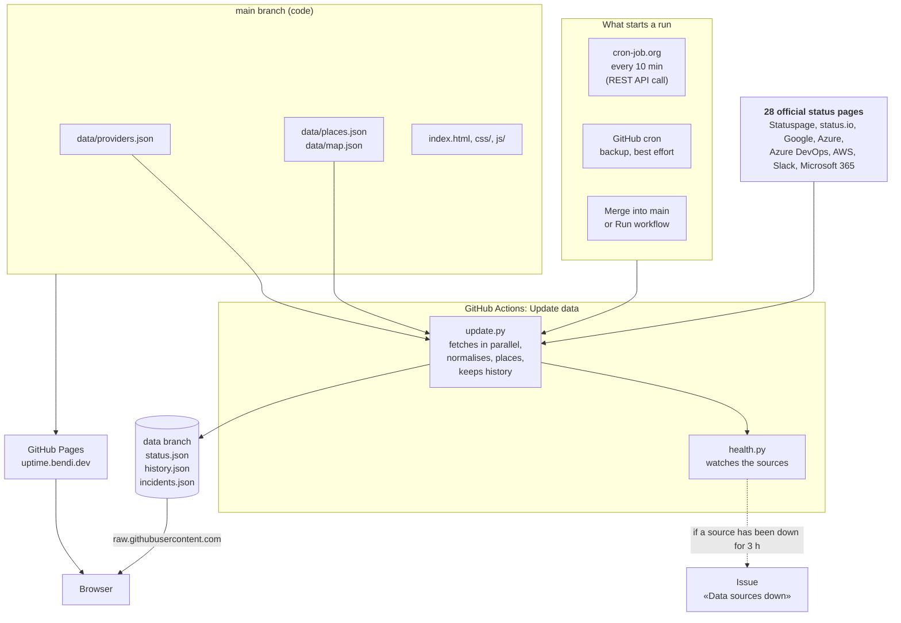

Everything runs on GitHub: the collector in Actions, the site on Pages and the data on its own branch. The only piece outside GitHub is the **clock**. GitHub's own scheduler doesn't guarantee when, or even whether, a scheduled workflow runs, so a free external service, [cron-job.org](https://cron-job.org), calls GitHub's API every 10 minutes to start the run. It only gives the order: it never sees the code, the data or the status pages. See [Triggering the runs](#triggering-the-runs).

### One run, step by step

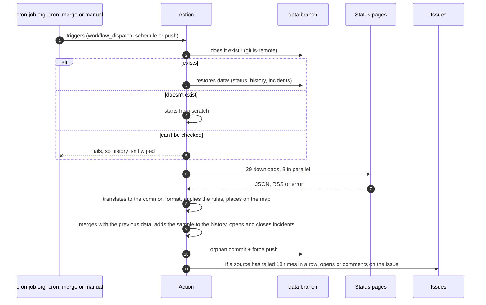

### Inside the site

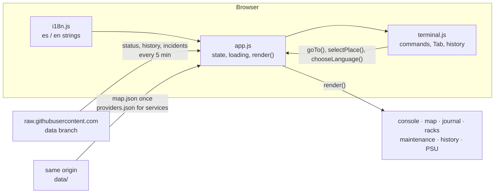

- **`i18n.js`** defines `LANGUAGES.es` and `LANGUAGES.en`, the `localStorage` keys (`STORAGE`) and `initialLanguage()`.
- **`app.js`** keeps everything in a single `state` object (data, history, incident log, map, language, filters, open drawers, selected place, pins) and has one function per block (`renderConsole`, `renderMap`, `renderJournal`, `renderRacks`…), which `render()` calls in order. Every data load and every language change repaints everything; small changes (opening a drawer, selecting a place, pinning) only touch their own part.
- **`terminal.js`** lives inside a closure and builds on `app.js`'s functions. It wraps `render()` to repaint its suggestions when the data or the language changes.
- No frameworks, no build step, no dependencies: three classic scripts, one stylesheet and one HTML file.

### Design decisions

| Decision | Why | Rejected alternative |
|---|---|---|
| **Read status pages, don't probe** | Pinging `github.com` from a GitHub runner tells you nothing useful, isn't polite, and can't see partial failures | Custom probes from Actions |
| **One common format** | The site knows nothing about Statuspage or RSS; adding a format doesn't touch the site | Teaching the site every format |
| **The worst signal wins** | Some providers are slow to move their overall indicator | Trusting the overall indicator |
| **Scope matters** | Without it, Cloudflare would always be red | Flagging an outage for any component |
| **Data on a separate branch** | `main` only gets code changes through PRs; `data` is a single commit that gets replaced, so it never grows | Committing data to `main` every 10 minutes |
| **An external clock** | GitHub's `schedule` is best effort: runs are delayed at busy times, skipped, and on this repository it never fired at all. A `workflow_dispatch` through the API starts within seconds | Relying only on GitHub's cron |
| **raw.githubusercontent.com** | Data updates without redeploying Pages, and without CORS issues | Publishing the data through Pages |
| **Our own history** | No public format offers 90 days of history consistently | Reading each provider's history |
| **A hand-made gazetteer** | No runtime dependencies or geocoding services, and full control over ambiguous names | A geocoding API |
| **The map as an LED matrix** | 6 KB, a single SVG element, fits the look and needs no map library | d3 with a 175 KB GeoJSON |
| **A single dark theme** | A NOC is a dark room, and the light comes from the LEDs | Light and dark themes |
| **A toy terminal** | Exploring the data by typing is fast for those who know how and fun for those who don't; clickable suggestions cover everyone else | Just another search box |

---

## Operations

### Workflows

| Workflow | When | What it does | Permissions |
|---|---|---|---|
| [`update-data.yml`](.github/workflows/update-data.yml) (*Update data*) | Every 10 minutes, started by [cron-job.org](#triggering-the-runs) through `workflow_dispatch`; GitHub's own cron (`3-59/10 * * * *`) as a backup; when changes to `scripts/`, `data/providers.json`, `data/places.json` or the workflow itself are merged into `main`; and manually | Restores the previous data, reads the status pages, publishes to `data`, and opens or closes the *Data sources down* issue | `contents: write`, `issues: write` |
| [`tests.yml`](.github/workflows/tests.yml) (*Tests*) | On every PR to `main` | `python -m unittest discover -s tests -v`. Its *Unit tests* check is required: a PR can't be merged until it passes | Defaults |
| `pages-build-deployment` | When `main` changes | GitHub Pages deployment | GitHub's |

GitHub's cron minute is offset from the top of the hour, which is when GitHub is busiest and most likely to delay scheduled runs. Even so, it's only a backup: the run every 10 minutes comes from cron-job.org.

### Triggering the runs

#### Why an external trigger

A workflow can be started in four ways, and they're not equally reliable:

| Trigger | Event | Reliable? |
|---|---|---|
| GitHub's cron | `schedule` | **No.** GitHub's documentation warns that scheduled runs can be delayed at busy times and some may be dropped; on new repositories they can take hours to start, and they're disabled after 60 days without activity. On this repository it never fired once |
| A merge into `main` | `push` | Yes, but only when the collector, the config or the workflow changes |
| *Run workflow* in the Actions tab | `workflow_dispatch` | Yes, within seconds, but someone has to click |
| A call to GitHub's REST API | `workflow_dispatch` | Yes, within seconds. **This is what cron-job.org does every 10 minutes** |

#### How it works

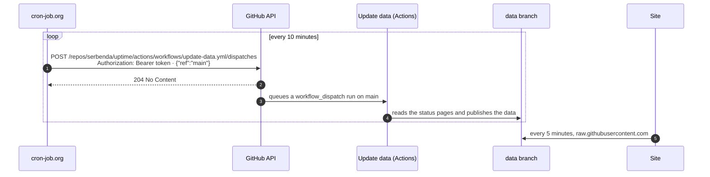

- cron-job.org sends one HTTP request and gets a `204`. That's all it does: the run itself happens in GitHub Actions, exactly as if someone had clicked *Run workflow*, with `publish` at its default (`true`).
- The call is authenticated with a **fine-grained personal access token** that can only touch this repository's Actions. It's stored in cron-job.org, never in the repository.
- If GitHub's own cron fires too, the two runs are queued by `concurrency: update-data` and simply run one after the other. Nothing breaks: the second one reads the status pages again.
- If cron-job.org goes down, GitHub's cron (if it's working), merges and manual runs keep updating the data, and the site warns when the data is more than 40 minutes old.

#### The token

| Setting | Value |
|---|---|
| Type | Fine-grained personal access token (Settings → Developer settings → Personal access tokens → *Fine-grained tokens*) |
| Name | `uptime-cron` |
| Repository access | *Only select repositories* → `serbenda/uptime` |
| Permissions | **Actions: Read and write**. GitHub adds *Metadata: Read-only*, which is mandatory. Nothing else |
| Expiration | One year at most. Note the date: when it expires the calls return `401` and the data stops updating |

**Creating it, step by step:**

1. On GitHub, open **[github.com/settings/personal-access-tokens/new](https://github.com/settings/personal-access-tokens/new)** (your avatar → **Settings** → **Developer settings** → **Personal access tokens** → **Fine-grained tokens** → **Generate new token**).
2. **Token name:** `uptime-cron`. **Description** (optional): `Triggers Update data every 10 minutes`.
3. **Resource owner:** `serbenda`.
4. **Expiration:** *Custom*, one year from today. Write the date down.
5. **Repository access:** **Only select repositories** → `serbenda/uptime`.
6. **Permissions** → **Repository permissions** → **Actions** → **Access: Read and write**. *Metadata: Read-only* is added automatically. Leave everything else, including *Account permissions*, at *No access*.
7. Check the summary says *1 repository* and *Actions: read and write*, then **Generate token**.
8. **Copy the token now** (`github_pat_…`, about 90 characters): GitHub only shows it once. Paste it straight into cron-job.org; don't save it in the repository or share it.

With it you can start, view and cancel this repository's workflow runs, and nothing more: it can't read or change the code, the data, the settings or any other repository. Never use a *classic* token here: those reach every repository on the account.

#### The cron-job.org job

**Creating it, step by step:**

1. Sign up for free at **[cron-job.org](https://cron-job.org)** and confirm your email.
2. **Dashboard** → **Cronjobs** → **Create cronjob**.
3. **Common** tab:
   - **Title:** `uptime update-data`
   - **URL:** `https://api.github.com/repos/serbenda/uptime/actions/workflows/update-data.yml/dispatches`
   - **Execution schedule:** *Every 10 minutes*
4. **Advanced** tab:
   - **Requires HTTP authentication:** unticked.
   - **Headers** → **Add header**, once per row:

     | Key | Value |
     |---|---|
     | `Authorization` | `Bearer github_pat_…` (the word `Bearer`, one space, then the whole token, no quotes) |
     | `Accept` | `application/vnd.github+json` |
     | `X-GitHub-Api-Version` | `2022-11-28` |
     | `Content-Type` | `application/json` |

   - **Request method:** `POST`
   - **Request body:** `{"ref":"main"}`
5. **Notifications** tab: tick *Notify me when execution fails*.
6. **Save**, then **⋯ → Test run** on the job. It must answer **204 No Content**, and a new `workflow_dispatch` run of *Update data* must appear in [Actions](https://github.com/serbenda/uptime/actions/workflows/update-data.yml).
7. Make sure the job is **Enabled**. From then on its history shows a `204` every 10 minutes.

In short, the job is:

| Field | Value |
|---|---|
| Title | `uptime update-data` |
| URL | `https://api.github.com/repos/serbenda/uptime/actions/workflows/update-data.yml/dispatches` |
| Schedule | Every 10 minutes |
| Request method | `POST` |
| Headers | `Authorization: Bearer github_pat_…` · `Accept: application/vnd.github+json` · `X-GitHub-Api-Version: 2022-11-28` · `Content-Type: application/json` |
| Request body | `{"ref":"main"}` |
| *Requires HTTP authentication* | Unticked: the token goes in the header |
| Notifications | *Notify me when execution fails* |

The expected answer is **204 No Content**:

| Answer | Meaning |
|---|---|
| `204` | The run was queued |
| `401` | Wrong or expired token, or missing `Bearer ` in front of it |
| `403` | The token lacks *Actions: Read and write* |
| `404` | Wrong URL, or the token isn't scoped to this repository |
| `422` | The body isn't `{"ref":"main"}`, or the workflow no longer has `workflow_dispatch` |

The same call can be made from any machine with `curl`, for example from a `crontab`:

```cron
*/10 * * * * curl -fsS -X POST -H "Accept: application/vnd.github+json" -H "Authorization: Bearer $(cat $HOME/.uptime-token)" -H "X-GitHub-Api-Version: 2022-11-28" https://api.github.com/repos/serbenda/uptime/actions/workflows/update-data.yml/dispatches -d '{"ref":"main"}'
```

cron-job.org is preferred because it doesn't depend on a machine being switched on, and it emails when a call fails.

#### Renewing the token

1. Before it expires: Settings → Developer settings → *Fine-grained tokens* → `uptime-cron` → **Regenerate token**, with a new expiration date.
2. In cron-job.org, edit the job and paste the new token into the `Authorization` header (`Bearer ` + token).
3. **Test run**: it should answer `204`, and a new `workflow_dispatch` run should appear in Actions.

If the token ever leaks, delete it on the same page: the old value stops working immediately.

### How the Actions fit together

From a change on `development` to fresh data on the site:

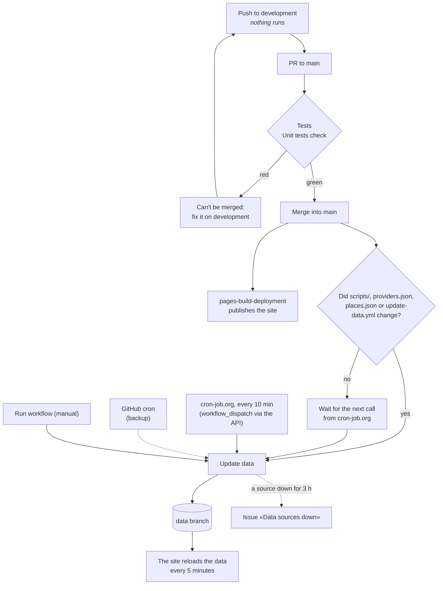

| Moment | What runs | What it guarantees |
|---|---|---|
| Push to `development` | Nothing | Work in progress costs nothing and blocks nothing |
| PR to `main` | *Tests* (the *Unit tests* check, about 15 s) | Every parser, rule and file in the config is checked before anything reaches `main` |
| Red tests | The PR can't be merged | `main` never gets code that breaks the collector |
| Merge into `main` | *pages-build-deployment*, and *Update data* if the collector, the config, the gazetteer or the workflow changed | The site and the data reflect the new code within a minute |
| Every 10 minutes | cron-job.org calls the API, which starts *Update data* (GitHub's cron, when it fires, does the same) | Fresh data, 90 days of history and incidents opened and closed |
| Manually | *Update data* (with *publish* unticked, to `data-test`) | Testing with real data without touching the site |
| A source down for 3 hours | *Update data* opens or comments on the *Data sources down* issue, and closes it when the source is back | Nobody has to keep an eye on the log |

The guarantee that red tests block a merge comes from a ruleset on `main` (see [Setting it up](#setting-it-up), step 6); the workflow alone only reports.

### Branch model

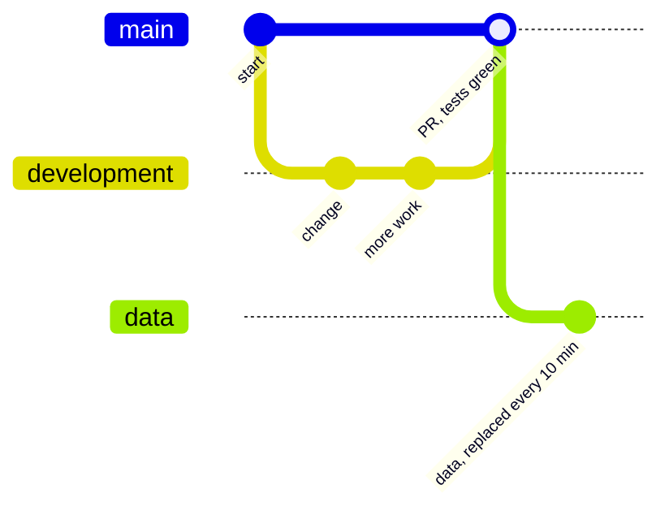

| Branch | Content | Written by |
|---|---|---|
| `development` | Where work happens. Protected against deletion and force pushes | People |
| `main` | What Pages serves and what every *Update data* run uses. Only takes changes through PRs, and only once the tests pass | PRs from `development` |
| `data` | The Action's output: a single orphan commit replaced with a *force push* | `github-actions[bot]` |
| `data-test` | Same as `data`, for test runs. The site doesn't read it | `github-actions[bot]` |

### Setting it up

1. Create the repository and push `main` with the code.
2. Settings → Pages → *Deploy from a branch* → `main`, folder `/` (root).
3. Custom domain: the [`CNAME`](CNAME) file says `uptime.bendi.dev`. In DNS, a `CNAME` record from `uptime` to `serbenda.github.io` (with Cloudflare, set to *DNS only* so GitHub can issue the certificate); then, in Settings → Pages, tick *Enforce HTTPS*. Without a custom domain, the site lives at `serbenda.github.io/uptime`, or at `<user domain>/uptime` if the account's user site has one.
4. Actions → *Update data* → *Run workflow*, to create the `data` branch straight away.
5. Check that the site loads and the console bar says `updated … ago`.
6. Protect the branches with two rulesets (Settings → Rules → Rulesets → *New branch ruleset*):

   | Ruleset | Target | Rules |
   |---|---|---|
   | `main: PR with passing tests` | `main` (*Include default branch*) | *Restrict deletions*, *Block force pushes*, *Require a pull request before merging* (0 approvals), *Require status checks to pass* with the *Unit tests* check |
   | `development: no force push` | `development` (*Include by pattern*: `development`) | *Restrict deletions*, *Block force pushes* |

   Both with enforcement *Active* and no bypass list. From then on `main` only changes through a PR with green tests, and `development` can't be deleted or rewritten. Don't add rules for `data` or `data-test`: the Action force-pushes to them.
7. Settings → General → *Social preview* → *Edit* → upload [`docs/logo/social.png`](docs/logo/social.png), so links to the repository show the logo on the LED map.
8. Create the [`uptime-cron` token](#the-token) and the [cron-job.org job](#the-cron-joborg-job) that starts *Update data* every 10 minutes. Check that its *Test run* answers `204` and that a `workflow_dispatch` run appears in Actions.

The repository itself needs no secrets or variables: every source is public. The only credential is the `uptime-cron` token, and it lives in cron-job.org.

### Reliability

| Risk | Mitigation |
|---|---|
| A provider doesn't respond | Its last good data is kept and its card says so |
| A provider changes its format | It raises `UnexpectedFormat` and is treated as that source being down, without breaking the rest |
| A source is down for a long time | After 18 runs in a row (3 hours), `health.py` opens the *Data sources down* issue, or comments on it if it's already open. Once every source responds again, the Action closes it with a comment |
| No source responds | Almost certainly the runner's network: the Action fails without publishing |
| `data` can't be read | The Action fails before publishing: it never overwrites the history with empty data |
| Half-written files | Each file is written to a `.tmp` and then renamed |
| Two runs at once | `concurrency: update-data` queues them |
| GitHub's cron runs late, skips runs or never starts | The runs every 10 minutes come from cron-job.org through the API; GitHub's cron is only a backup |
| cron-job.org is down or its call fails | GitHub's cron (if it fires), merges and manual runs still update the data; cron-job.org emails about the failure, and the site warns when data is more than 40 minutes old |
| The `uptime-cron` token expires or is revoked | The calls return `401` and cron-job.org emails about it; [renew it](#renewing-the-token) |
| The token leaks | It can only start and cancel this repository's workflow runs; delete it and create a new one |
| The browser mixes versions | CSS and JS links carry `?v=N`, bumped on every change |
| Huge or odd responses | Text is stripped of HTML and trimmed (600 characters per message, 200 per title); at most 12 components and 80 points per provider |
| raw.githubusercontent.com caching | About 5 minutes; the site requests data with a parameter that changes every minute and `cache: no-store` |

### Testing changes with real data without touching the site

Actions → *Update data* → *Run workflow* → branch `development`, with **publish** unticked. The data is written to `data-test`:

```bash
git fetch origin data-test
git show origin/data-test:data/status.json | python3 -m json.tool | less
```

### What it writes to the log

Every run leaves one line per provider in the Action's log:

```
[ok ] GitHub                   operational     0 incidents
[ok ] Cloudflare               major outage    0 incidents
[ERR] OpenAI                   no data         0 incidents  TimeoutError: timed out
```

And `health.py` prints either `All sources are responding.` or the issue's table:

| Provider | Error | Failures in a row | Last good data |
|---|---|---|---|
| OpenAI | HTTP 503 | 18 | 2026-11-02T08:13:36Z |

### Costs and limits

| Resource | Usage | Cost |
|---|---|---|
| GitHub Actions | About 144 runs a day (more if GitHub's cron also fires), under a minute each | Free for public repositories |
| cron-job.org | 144 calls a day | Free |
| GitHub Pages | About 90 KB of site, including the map | Free |
| `data` branch | About 250 KB with 90 days of history; it doesn't grow, since it's a single commit | Free |
| Requests to providers | 29 every 10 minutes (Microsoft 365 needs two), with a `User-Agent` that identifies the project | Status pages are public and meant for this |

### Troubleshooting

| Symptom | What to check |
|---|---|
| The site says data is running late | Actions → *Update data*: is there a `workflow_dispatch` run every 10 minutes? If not, check the job's history in cron-job.org. Meanwhile, *Run workflow* by hand. |
| cron-job.org answers `401` | The token is wrong, expired or missing `Bearer ` in front: [renew it](#renewing-the-token). |
| cron-job.org answers `403` or `404` | The token lacks *Actions: Read and write*, isn't scoped to `serbenda/uptime`, or the URL is wrong. See [the job's answers](#the-cron-joborg-job). |
| There are only `push` and `workflow_dispatch` runs, never `schedule` | GitHub's cron isn't firing. It's expected and harmless: cron-job.org covers it. GitHub also disables scheduled workflows in repositories with no activity for 60 days; a commit re-enables them. |
| The *Data sources down* issue appears | The issue says which provider and which error, and gets a new comment on every run while it lasts. It closes itself when every source responds again; you don't need to close it. If it's *unexpected format*, its page has changed and its parser or `type` needs updating. If it's HTTP 404, its address may have changed. |
| A provider's status doesn't match its website | Check its drawer: it may be the worst-signal rule (a component down with the indicator green) or the scope rule. |
| The map shows no dots | Is anything failing? If so, and everything is under *no specific location*, the names contain no recognisable places. If a city is missing, add it to `places_base.json`. |
| A dot sits in the middle of a country | Its city isn't in the gazetteer: add it with its IATA code. |
| The site doesn't load data | Check that the `data` branch exists, and check the `<meta name="uptime-data">` tag in `index.html`. |
| The site looks broken after a deploy | Bump the `?v=N` number in `index.html`. |
| The terminal says *offline* | The data hasn't loaded: same problem as the row above. |

---

## Development

### Layout

```
uptime/
├── index.html                    Single page
├── css/style.css                 Styles: room, console, terminal, map, racks, drawers and PSU
├── js/
│   ├── i18n.js                   English and Spanish strings, storage keys and the initial language
│   ├── app.js                    State, loading, console, map, journal, racks, drawers, filters and notifications
│   └── terminal.js               The console's command line
├── data/
│   ├── providers.json            What is queried and in which format
│   ├── map.json                  World map as an LED matrix (generated)
│   ├── places.json               Compiled gazetteer (generated)
│   └── geo/
│       ├── places_base.json      Cities, regions, zones and aliases (hand-made)
│       ├── world.geojson         Borders of 180 countries (public domain)
│       └── countries.json        ISO 3166 names in English and Spanish
├── scripts/
│   ├── update.py                 Fetches, normalises, places and keeps the history
│   ├── build_map.py              Builds map.json and places.json from data/geo/
│   ├── build_brand.py            Builds the logo, mark, favicon and animated terminal in docs/logo/
│   ├── screenshots.py            Takes the README screenshots and the social preview (needs a browser)
│   └── health.py                 Report of failing sources, for the issue
├── tests/test_update.py          Tests with sample responses for each format
├── docs/
│   ├── logo/                     Logo, mark, favicon, social preview and the animated terminal
│   └── screenshots/              Screenshots for this README
└── .github/
    ├── workflows/                update-data.yml and tests.yml
    └── FUNDING.yml               The repository's Sponsor button
```

Everything in the code is in English: file names, identifiers, comments, log messages and data keys. Only the site's Spanish strings (in `js/i18n.js`) and the Spanish aliases the terminal accepts (`ayuda`, `servicios`, `salir`…) are in Spanish.

There's no generated data on `main`: `status.json`, `history.json` and `incidents.json` are in `.gitignore` and live on the `data` branch.

### Making a change, step by step

Every change follows the same path, from `development` to the live site:

```bash
# 1. Start from the latest development
git checkout development
git pull

# 2. Make the change, then run the tests
python3 -m unittest discover -s tests -v

# 3. Try it in the browser with real data (see Running it locally)
python3 -m http.server 8000

# 4. Commit and push to development (nothing runs on GitHub yet)
git add -A
git commit -m "What changes and why"
git push origin development
```

5. On GitHub, open a PR from `development` to `main`. *Tests* runs and adds the *Unit tests* check.
6. If it's red, fix it on `development` and push again: the PR updates itself and the check runs again. A red PR can't be merged.
7. When it's green, merge it. *pages-build-deployment* publishes the site, and *Update data* runs straight away if the collector, the config, the gazetteer or the workflow changed.
8. Check [uptime.bendi.dev](https://uptime.bendi.dev): the console bar should say `updated … ago`. If the change touched the data, also check the latest *Update data* run in Actions.

Before committing, check this list against what you've changed:

| If you changed… | Also do this |
|---|---|
| `css/` or `js/` | Bump the file's `?v=N` in `index.html`, so browsers don't mix versions |
| A text on the site | Change it in both `es` and `en` in `js/i18n.js` |
| `data/providers.json` | Nothing else: the tests check it and the next run picks it up |
| `data/geo/` | `python3 scripts/build_map.py`, and commit `data/map.json` and `data/places.json` too |
| The collector's rules or a parser | Add or update a test in `tests/test_update.py` |
| The logo, the mark or the animated terminal | `python3 scripts/build_brand.py` |
| How the site looks | `python3 scripts/screenshots.py`, so the README screenshots match |
| A workflow | Its documentation in [Operations](#operations) |
| Anything users or maintainers would notice | This README |

### Regenerating the brand and the screenshots

Everything in `docs/` can be rebuilt from the repository:

```bash
# Logo, mark, favicon and animated terminal (standard library only)
python3 scripts/build_brand.py

# README screenshots and social preview: they need a browser, and look best with real data
pip install playwright pillow
playwright install chromium
git fetch origin data
for f in status history incidents; do git show origin/data:data/$f.json > data/$f.json; done
python3 scripts/screenshots.py
```

`build_brand.py` draws everything from code (the word is made of stroked paths, so no font is involved) and is deterministic: running it on an unchanged repository changes nothing. `screenshots.py` serves the site locally, opens it in headless Chromium in English and Spanish, on desktop and mobile, types a few commands into the terminal, and saves every screenshot as WebP. It also renders the 1280 × 640 social preview with the LED map and the failures in your local `data/status.json`. If the favicon changes, copy its drawing to the `<link rel="icon">` in `index.html` and to `renderConsole()` in `js/app.js`, where its LED is coloured by status. After regenerating the social preview, upload it again under Settings → *Social preview*.

### Running it locally

```bash
# Tests
python3 -m unittest discover -s tests -v

# Real data (writes status.json, history.json and incidents.json to data/)
python3 scripts/update.py

# Or the published data, without querying anyone
git fetch origin data
for f in status history incidents; do git show origin/data:data/$f.json > data/$f.json; done

# Site: on localhost it reads data/ instead of the data branch
python3 -m http.server 8000      # http://localhost:8000

# If you change data/geo/
python3 scripts/build_map.py
```

`UPTIME_OUTPUT=/path` changes where `update.py` writes (the Action uses it to write into its copy of the `data` branch).

### Constants

<details>
<summary><b>All tunable constants, in the collector and in the site</b></summary>

In [`update.py`](scripts/update.py):

| Constant | Value | Purpose |
|---|---|---|
| `HISTORY_DAYS` | 90 | Days of daily history |
| `INCIDENT_DAYS` | 30 | Days closed incidents are kept |
| `FAILURES_BEFORE_ALERT` | 18 | Failed runs in a row (3 h) before a source becomes *no data* and the issue is opened |
| `MIN_SCOPE` | 0.05 | Share of components below which the *degraded* cap applies |
| `MIN_COMPONENTS` | 20 | Minimum number of components for that rule |
| `MAX_COMPONENTS` | 12 | Affected components stored per provider |
| `MAX_TEXT` | 600 | Characters kept from each incident's latest message |
| `MAX_PLACES` | 80 | Map points per provider |
| `MAX_EXAMPLES` | 4 | Source texts stored per point |
| `TIMEOUT` | 20 | Seconds per download |
| `RETRIES` | 2 | Retries per download |
| `USER_AGENT` | `uptime/1.0 (+https://github.com/serbenda/uptime)` | Requests' `User-Agent` |

In the site:

| Constant | Where | Value | Purpose |
|---|---|---|---|
| `REFRESH_MS` | `app.js` | 5 min | How often data is reloaded |
| `STALE_MIN` | `app.js` | 40 min | When to warn that data is running late |
| `DAYS` | `app.js` | 90 | Bars in each server's graph |
| `LIMIT` | `app.js` | 8 | Incidents shown before *more entries* |
| `PER_PROVIDER` | `app.js` | 3 | Maintenance windows shown per provider |
| `MAX_NODES` | `terminal.js` | 300 | Output lines kept by the terminal |

</details>

### The common provider format

This is what every `parse_<type>()` returns and what the site reads. `empty()` provides the template.

```python
{
  "status": "operational|maintenance|degraded|partial|major",
  "description": "text published by the provider, or ''",
  "components": [{"name": "…", "status": "…"}],          # affected only, at most 12
  "total_components": 0,                                # 0 if the format has no components
  "affected": 0,                                        # filled in by final_status()
  "limited_scope": False,                               # filled in by final_status()
  "incidents": [{
      "id": "…", "title": "…", "impact": "advisory|degraded|partial|major",
      "phase": "Investigating…", "started": "ISO", "updated": "ISO",
      "message": "latest message", "link": "https://…",
      "affects": ["product"],                           # optional
      "place_texts": ["text with places"],              # optional, only used to place it; not stored
  }],
  "maintenance": [{"id": "…", "title": "…", "phase": "…", "in_progress": False,
                   "start": "ISO", "end": "ISO", "link": "https://…"}],
  "places": [],                                         # filled in by final_status()
  "unlocated": 0,                                       # filled in by final_status()
}
```

### Tests

[`tests/test_update.py`](tests/test_update.py) has 41 `unittest` tests built on sample responses for each format. They don't connect to anything: if a provider changes its format, these tests won't notice, but the Action will (it flags it as an *unexpected format* and, if it persists, opens the issue).

<details>
<summary><b>What each test class covers</b></summary>

| Class | What it checks |
|---|---|
| `TestHelpers` | The level scale, dates (ISO, RFC 822, seconds and milliseconds since 1970), HTML stripping and UTF-16 JSON |
| `TestStatuspage` | All clear, incidents and components, groups not counting, maintenance, broken format, the scope rule and advisories (by impact and by title) |
| `TestStatusio`, `TestGoogle`, `TestAzure`, `TestAzureDevOps`, `TestAws`, `TestSlack` | Each format: normal case, incidents, empty and broken; for Azure DevOps, that maintenance doesn't count as degraded |
| `TestMicrosoft365` | All clear, *Service restored*, a worldwide outage from the admin center, a single consumer service, unknown states, Microsoft's `0001-01-01` empty dates, broken documents and the fallback to the second host |
| `TestPlaces` | 13 real-world texts with their expected result (Cloudflare, Linode, AWS, Google, Azure, Akamai, acronyms that aren't airports…), that the gazetteer has no broken references, and that `place_failures()` merges, ranks and skips advisories |
| `TestFetching` | URLs, that a network or format error doesn't break anything, and that every provider in the config is valid |
| `TestPersistence` | That a failing source keeps its data and becomes *no data* on time, that history is trimmed and doesn't count what wasn't measured, and that incidents open and close (and don't close when the source fails) |

</details>

The site has no automated tests; it's checked in the browser, on desktop and mobile, in both languages.

### Strings and languages

Every string on the site lives in [`js/i18n.js`](js/i18n.js), with both versions side by side:

- Fixed text in the HTML carries `data-i18n="key"` (content), `data-i18n-aria="key"` (`aria-label`) or `data-i18n-ph="key"` (`placeholder`).
- Sentences with data in them are functions, so each language can order its words and handle plurals its own way: `having_problems: (names, n) => \`${names} ${n === 1 ? "is" : "are"} having problems.\``.
- The terminal has its own block, `term`, with each command's description and usage.

To add a string, add the same key to both `es` and `en`. To add a language, copy the `en` block under a new code, translate it and add its button to the console's switcher; `initialLanguage()` and everything else pick it up automatically.

### Design

| Token | Value | Used for |
|---|---|---|
| `--room` | `#0F151B` | Background, with a faint raised-floor grid |
| `--metal` | `#18212A` | Rack frames |
| `--face` | `#222D38` | Server faces |
| `--terminal` | `#0A1016` | Console, drawers, journal, map |
| `--ink` | `#DCE6EE` | Main text |
| `--prompt` | `#6FB7FF` | Prompt, terminal links, focus |
| `--operational` · `--maintenance` · `--degraded` · `--partial` · `--major` · `--unknown` · `--advisory` | `#43D17F` · `#5AA9FF` · `#F2C230` · `#FF8A2A` · `#FF4D4D` · `#6B7885` · `#B79CFF` | The LEDs |

- **Logo**: the word *uptime* is drawn by hand as stroked paths (no font needed, so it renders the same everywhere), and the dot on the **i** is the status LED. Next to it, the mark: a 1U server with its LED and the 90-day bars, the most uptime-specific element on the site.

  | File | Use |
  |---|---|
  | [`docs/logo/logo-dark.svg`](docs/logo/logo-dark.svg) | Logo for dark backgrounds. The site inlines it at the top, with both LEDs coloured by the worst status |
  | [`docs/logo/logo-light.svg`](docs/logo/logo-light.svg) | Logo for light backgrounds |
  | [`docs/logo/mark.svg`](docs/logo/mark.svg) | Square mark, for avatars |
  | [`docs/logo/favicon.svg`](docs/logo/favicon.svg) | Simplified mark for 16–32 px; on the site its LED takes the colour of the worst status |
  | [`docs/logo/social.png`](docs/logo/social.png) | 1280 × 640 preview for links (Open Graph), with the LED map |
  | [`docs/logo/terminal.svg`](docs/logo/terminal.svg) | The animated terminal at the top of this README (CSS animation, respects reduced motion) |

  The SVGs come from [`build_brand.py`](scripts/build_brand.py) and the PNG from [`screenshots.py`](scripts/screenshots.py): see [Regenerating the brand and the screenshots](#regenerating-the-brand-and-the-screenshots).

- **Type**: [Archivo](https://fonts.google.com/specimen/Archivo), with variable width (narrow in the verdict and headings), for labels; [JetBrains Mono](https://fonts.google.com/specimen/JetBrains+Mono) for anything that comes out of a terminal.
- **Colour means something**: bright colours are reserved for LEDs and statuses; everything else is metal and ink.
- **A single entrance animation**: the console typing itself. All other motion responds to something (an LED warning you, a dot pulsing, a drawer sliding out).

### Conventions

- Python 3.12, standard library only. JavaScript with no frameworks and no build step.
- Code, comments, data keys and documentation in English; the site's text in English and Spanish. Provider ids are lowercase with hyphens.
- Work happens on `development`; `main` is only reached through PRs.
- If you change CSS or JS, bump the `?v=N` in `index.html`.
- If you change `data/geo/`, regenerate with `build_map.py` and commit the generated files too.

---

## Data formats

### On the `data` branch

#### `status.json`

<details>
<summary><b>Full example and field reference</b></summary>

```json
{
  "updated": "2026-11-02T15:53:36Z",
  "categories": {"cloud": "Cloud", "dev": "Development", "network": "Network & CDN", "collab": "Collaboration", "ai": "AI"},
  "summary": {"total": 28, "failing": 5, "worst": "major", "no_data": 0},
  "providers": [
    {
      "id": "linode",
      "name": "Akamai Cloud (Linode)",
      "category": "cloud",
      "web": "https://status.linode.com",
      "status": "degraded",
      "description": "Partially Degraded Service",
      "components": [{"name": "US-Southeast (Atlanta)", "status": "degraded"}],
      "total_components": 242,
      "affected": 1,
      "limited_scope": true,
      "incidents": [{
        "id": "nt58zhx3pmgm",
        "title": "Customer Security Advisory: CVE-2026-98432",
        "impact": "advisory",
        "phase": "Investigating",
        "started": "2026-10-30T18:10:58Z",
        "updated": "2026-11-02T10:55:43Z",
        "message": "While we continue to deploy kernel patches across our infrastructure…",
        "link": "https://stspg.io/9pzh45ps11bv"
      }],
      "maintenance": [{
        "id": "jkxgzslpmgl4",
        "title": "Scheduled Longview Maintenance - US-Central (Dallas)",
        "phase": "Scheduled",
        "in_progress": false,
        "start": "2026-11-03T05:30:00Z",
        "end": "2026-11-03T11:30:00Z",
        "link": "https://stspg.io/00rz5txrcy3z"
      }],
      "places": [{
        "id": "@ATL", "en": "Atlanta", "es": "Atlanta", "lat": 33.75, "lon": -84.39,
        "country": "USA", "country_en": "United States", "country_es": "Estados Unidos",
        "level": "degraded", "n": 2,
        "examples": [
          {"t": "US-Southeast (Atlanta)", "level": "degraded"},
          {"t": "Service Issue - US-Southeast (Atlanta)", "level": "degraded"}
        ]
      }],
      "unlocated": 0,
      "source": {
        "checked": "2026-11-02T15:53:36Z",
        "ok": true,
        "error": null,
        "failures_in_a_row": 0,
        "last_ok": "2026-11-02T15:53:36Z"
      }
    }
  ]
}
```

| Field | Type | Meaning |
|---|---|---|
| `updated` | ISO 8601 UTC | When the run finished |
| `categories` | object | The racks, in the order they're drawn |
| `summary.total` · `failing` · `worst` · `no_data` | number · number · level · number | Global summary: total, failing, worst level, without data |
| `providers[].status` | level or `unknown` | Final status, after the rules |
| `providers[].description` | text | The sentence the provider itself publishes, or empty when all is well |
| `providers[].components` | list | Affected components, worst first, at most 12 |
| `providers[].total_components` · `affected` | number | Totals, for the `59 of 473` line |
| `providers[].limited_scope` | boolean | Whether the *degraded* cap was applied |
| `providers[].incidents[].impact` | level or `advisory` | Each incident's severity |
| `providers[].incidents[].phase` | text | Phase, normalised to English (*Investigating*, *Monitoring*…); the Spanish site translates it |
| `providers[].places[]` | list | Map points, worst first, at most 80 |
| `providers[].places[].id` | text | `@IAH` city, `USA` country, `Z:europe` zone |
| `providers[].places[].n` | number | How many components and incidents placed it there |
| `providers[].unlocated` | number | Failures that couldn't be placed |
| `providers[].source` | object | Status page health: last check, whether it responded, error, consecutive failures and last good data |

</details>

#### `history.json`

```json
{"aws": {"2026-11-01": {"samples": 144, "down": 144, "worst": "partial"}, "2026-11-02": {"samples": 96, "down": 96, "worst": "partial"}}}
```

Per provider and UTC day: samples (`samples`), samples with a partial or major outage (`down`) and the day's worst status (`worst`). Trimmed to 90 days.

#### `incidents.json`

```json
{
  "aws:arn:aws:health:me-central-1::event/MULTIPLE_SERVICES/…": {
    "provider": "aws",
    "title": "Multiple services (UAE): Region Availability",
    "impact": "partial",
    "started": "2026-03-01T12:51:25Z",
    "seen": "2026-11-02T15:53:36Z",
    "ended": null,
    "link": "https://health.aws.amazon.com/health/status"
  }
}
```

The key is `provider:id`. An incident opens the first time it's seen and closes (`ended` = the last time it was seen) once it no longer appears on the provider's page. If the source fails, its open incidents aren't closed. `impact` holds the worst level seen, unless the incident becomes an advisory. Closed incidents are deleted after 30 days.

### On `main`

#### `data/providers.json`

`{"categories": {id: name}, "providers": [one line per provider]}`. See [Adding a provider](#adding-a-provider).

#### `data/map.json`

```json
{"step": 1.5, "lat_max": 82.0, "columns": 240, "rows": ["0000000001fffffffc00…", "…"]}
```

93 rows (from 82° N to 56° S, every 1.5°) of 60 hexadecimal characters: each character is 4 dots of the row, left to right, with `1` for land. Odd rows are shifted half a dot east.

#### `data/places.json`

```json
{
  "regions":   {"us-east-1": "@IAD", "West Europe": "@AMS", "…": "…"},
  "iata":      {"IAH": "@IAH", "…": "…"},
  "cities":    {"Houston": "@IAH", "London": "@LHR", "Londres": "@LHR", "…": "…"},
  "countries": {"Spain": "ESP", "España": "ESP", "UK": "GBR", "…": "…"},
  "zones":     {"Europe": "Z:europe", "APAC": "Z:apac", "…": "…"},
  "places":    {"@IAH": {"en": "Houston", "es": "Houston", "lat": 29.76, "lon": -95.37, "country": "USA",
                         "country_en": "United States", "country_es": "Estados Unidos"},
                "ESP":  {"en": "Spain", "es": "España", "lat": 40.35, "lon": -3.62},
                "…": "…"}
}
```

The first five tables map a name to an id; `places` maps an id to its name in both languages and its coordinates.

### In the browser

| `localStorage` key | What it stores |
|---|---|
| `uptime.language` | `es` or `en` |
| `uptime.pinned` | Ids of pinned services |
| `uptime.history` | The last 50 terminal commands |

Every read and write is wrapped in `try/catch`: if the browser won't store anything (private mode, blocked storage), the site works the same and just forgets on reload.

---

## Security and privacy

- **No servers, no accounts, no cookies, no personal data.** The page is static. The only thing it sends is an anonymous visit count to [GoatCounter](https://www.goatcounter.com/), which uses no cookies and stores no personal data, so I can see how many people use it.
- **The terminal doesn't execute anything**: it's a fixed-command interpreter written in JavaScript. What you type never leaves the browser, and it's always rendered as text (`textContent`), never as HTML.
- **Provider text** is stripped of tags by the collector and inserted as text on the site, so an incident title containing HTML can't inject anything.
- **External links** open with `rel="noopener"`.
- **Notifications** are local: the tab itself generates them when it sees a change in the data. There's no *push* and no subscription.
- **The Action** only has `contents: write` (to publish to `data`) and `issues: write` (to raise the alarm). It uses no secrets.
- **The external trigger** uses a fine-grained token limited to this repository's Actions, stored only in cron-job.org. cron-job.org sends one request to GitHub's API and never sees the code, the data or the status pages.
- **Polite requests**: 29 every 10 minutes, to public pages built for this, with a `User-Agent` that says who's asking.
- **Third parties on the site**: fonts from Google Fonts, and data from `raw.githubusercontent.com`.

---

## FAQ

**Why doesn't it ping the services?**
Because a ping from a GitHub runner only tells you whether that runner can reach that server. It can't see an Actions outage in Europe, a billing problem or an AWS region going down. Status pages can, and they're the source the providers themselves maintain. The terminal's `ping` command explains this too.

**Why does a provider show failures when its website says "All Systems Operational"?**
Because the worst signal wins: it may have an affected component or an open incident while its overall indicator is green. Its drawer tells you exactly what.

**And the other way round: why is Cloudflare degraded and not red, with cities down?**
Because of the scope rule: fewer than 5% of components affected, with no serious incident, means degraded. On the map, those cities do show up in red.

**Why has AWS had an incident open since March?**
Because AWS is still publishing it: they're events for its Middle East regions (UAE and Bahrain). uptime shows what the provider publishes.

**Why does a service show 0.00% availability?**
Because every sample measured so far had a partial or major outage open. With only a few days of history the number is very sensitive; with 90, it settles.

**Is it real time?**
Almost: data is updated every 10 minutes (cron-job.org starts the run) and the site reloads it every 5. A problem a provider publishes at 10:02 shows up by around 10:20 at the latest.

**What does Microsoft 365 cover?**
What Microsoft publishes on its public status page, [status.cloud.microsoft](https://status.cloud.microsoft/): broad incidents announced through the admin center (like a worldwide Outlook or Teams outage) and the status of each consumer service (Outlook.com, OneDrive, Teams free…). It isn't any company's tenant health: an incident that only affects some tenants appears only in each tenant's *Service health*, behind a sign-in.

**Why does it need cron-job.org if everything runs on GitHub?**
Because GitHub's scheduler doesn't guarantee when, or whether, a scheduled workflow runs; on this repository it never ran at all. cron-job.org only acts as the clock: every 10 minutes it asks GitHub's API to start *Update data*, and the run itself happens in GitHub Actions.

**Can I add a service?**
Yes, if it has a public status page in one of the known formats: it's one line in `data/providers.json`. See [Adding a provider](#adding-a-provider).

**Is it official?**
No. It's a personal project with no relationship to any of the providers. Names and trademarks belong to their owners.

**Why "NOC", and why `bendi@noc`?**
A NOC is a *Network Operations Center*, the room where people make sure everything keeps working. `noc` is the machine's name in the prompt: you're logged into the NOC's terminal.

**What language is the code in?**
English: file names, identifiers, comments, logs and data keys. The site speaks English and Spanish, and the terminal also understands a few Spanish aliases (`ayuda`, `servicios`, `salir`).

---

## Known limitations

- **It only knows what gets published.** If a provider is slow to acknowledge an outage, so is uptime; if it never publishes it, it didn't happen.
- **The granularity is 10 minutes**, and it depends on an external clock (cron-job.org) and a token that expires once a year. A 5-minute outage between two samples may go unseen.
- **The map depends on names.** An incident titled *Elevated errors for some customers* has nowhere to go, and a place missing from the gazetteer lands in the middle of its country.
- **Cities with the same name resolve to the one in the gazetteer**: `Santiago` is Santiago de Chile, `Portland` is Portland, Oregon.
- **Azure and AWS give little detail**: Azure only publishes active incidents as RSS, without components; AWS, standalone events. Their statuses are coarser as a result (everything is a *partial outage*).
- **Percentages aren't SLAs**: they're time with a published partial or major outage, measured in 10-minute samples.
- **Security advisories are recognised by their title.** An advisory with a different title would count as a degradation.
- **Browser notifications** only work while the tab is open.

---

## Roadmap

- [ ] More providers: Oracle Cloud, IBM Cloud, Fastly, Datadog, Sentry, Stripe.
- [ ] Docker Hub is moving its status page to incident.io: its parser will need updating when it switches.
- [ ] uptime's own RSS feed with every provider's incidents.
- [ ] Telegram or email alerts for pinned services, without keeping the page open.
- [ ] Correlation view: several providers failing in the same place at once usually points to a shared third party (a cable, a shared data centre).
- [ ] More cities in the gazetteer, as they appear in the data.
- [ ] Automated tests for the site.

---

## Credits

| What | Where from | Licence |
|---|---|---|
| Service status | Each provider's official status page | Public; data and trademarks belong to their owners |
| Country borders | [world.geo.json](https://github.com/johan/world.geo.json), the same as atalaya | Public domain |
| Country names | ISO 3166, in English and Spanish, the same as atalaya | |
| Cities, regions and zones | Hand-made compilation in `places_base.json` | |
| Typefaces | [Archivo](https://fonts.google.com/specimen/Archivo) and [JetBrains Mono](https://fonts.google.com/specimen/JetBrains+Mono), via Google Fonts | SIL Open Font License |
| Infrastructure | GitHub Actions and GitHub Pages | |

A sibling of [atalaya](https://github.com/serbenda/atalaya). Made by [Bendi](https://bendi.dev).

---

## Support the project

<a href="https://github.com/sponsors/serbenda"></a>

uptime is a personal project: free, with no ads and no cookies. If it's ever saved you from an "is it me or is it them?", you can help keep the lights on through [GitHub Sponsors](https://github.com/sponsors/serbenda). On the site it's the NOC's power supply, and in the terminal, `sponsor`.

<br>

<div align="center">

<br>
<sub><code>bendi@noc:~$ exit</code><br>There's no way out: this is a NOC.</sub>
</div>
