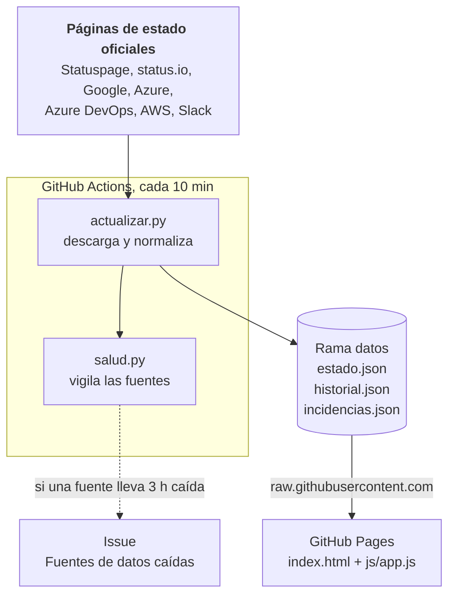
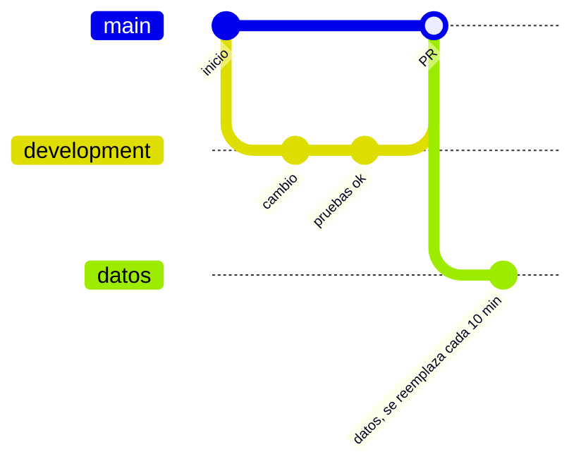

<div align="center">

# uptime

**¿Está caído o soy yo?**

Estado en tiempo real de los servicios informáticos que usamos a diario: GitHub, Microsoft Azure,<br>
Red Hat, Google Cloud, AWS, Cloudflare y más. Incidencias, mantenimientos y caídas en un solo panel.

[](https://github.com/serbenda/uptime/actions/workflows/actualizar.yml)
[](https://github.com/serbenda/uptime/actions/workflows/pruebas.yml)
[](https://github.com/sponsors/serbenda)

**Castellano** · [English](README.en.md)

</div>

> [!NOTE]
> uptime **no mide** los servicios por su cuenta: lee lo que cada proveedor publica en su página de estado oficial. Si un proveedor tarda en reconocer un problema, o no lo publica, aquí tampoco aparece. Los porcentajes de disponibilidad son una estimación a partir de esas páginas, no el SLA de nadie.

---

## Índice

- [Qué es](#qué-es)
- [Lo que ves en la web](#lo-que-ves-en-la-web)
- [Proveedores](#proveedores)
- [Mapa de fallos](#mapa-de-fallos)
- [Arquitectura](#arquitectura)
- [Sistemas y DevOps](#sistemas-y-devops)
- [Desarrollo](#desarrollo)
- [Datos](#datos)
- [Hoja de ruta](#hoja-de-ruta)
- [Apoya el proyecto](#apoya-el-proyecto)

---

## Qué es

Cuando algo falla, la primera pregunta es si el problema es tuyo o del proveedor. uptime reúne en una sola página el estado de los servicios de los que depende casi cualquier equipo técnico: nubes, forjas de código, registros de paquetes, CDN y herramientas de colaboración. Cada 10 minutos consulta sus páginas de estado oficiales, las traduce a un formato común y guarda el historial.

Es hermano de [atalaya](https://github.com/serbenda/atalaya): misma filosofía de **cero servidores y cero costes**. Todo corre en GitHub Actions y GitHub Pages, con Python sin dependencias y una página estática.

## Lo que ves en la web

La web es un NOC (centro de operaciones de red): cada categoría es un rack y cada proveedor, un servidor con su LED de estado.

| Parte | Para qué sirve |
|---|---|
| **Idioma** | Castellano o inglés, según el navegador. Se cambia en la barra de la consola (`LANG= es_ES en_US`) o con `?lang=en`, y se recuerda. |
| **Consola** | Una sesión de terminal que ejecuta `uptime` y `systemctl --failed`. Responde a la pregunta con `[  OK  ] Todo funciona.` o `[FAILED] GitHub y Azure tienen problemas.` y lista los servicios con fallos. El *load average* es real: la fracción de servicios con caída ahora, de media en 7 días y en 30 días. El favicon y el título de la pestaña también cambian de color. |
| **Mapa de fallos** | Un mapamundi hecho de LED, con un punto encendido en cada lugar donde hay algo fallando: el color es el peor estado, el tamaño cuántos fallos hay y los graves laten. Al pasar por encima se ve quién falla; al pulsar, un `geoiplookup` con cada proveedor y qué componente o incidencia lo ha puesto ahí. Al lado, la lista de lugares y los proveedores con fallos sin ubicación concreta. |
| **Incidencias abiertas** | Un `journalctl` con todas las incidencias activas, de más a menos graves. Cada línea se despliega con la fase, el último mensaje del proveedor y el enlace. |
| **Racks** | Un rack por categoría (nube, desarrollo, red y CDN, colaboración, IA). Cada servidor tiene su LED (parpadea si hay fallos), su estado, una gráfica de 90 días y un display con la disponibilidad. |
| **Cajón** | Al pulsar un servidor, se extrae y muestra su terminal: `status github` con estado, fuente, disponibilidad, componentes afectados, incidencias con su último mensaje y mantenimientos. |
| **Filtros** | `grep -i` para buscar y *flags* para elegir rack (`--nube`, `--desarrollo`…) o ver solo los que fallan (`--solo-fallos`). |
| **Fijados** | La chincheta de cada servidor lo sube a un rack *Fijados*. Con *Avisarme si falla uno fijado*, el navegador avisa cuando empeora o se recupera, mientras la página esté abierta. Se guarda en tu navegador, sin cuentas. |
| **Mantenimientos** | Un `crontab -l` con los mantenimientos en curso y los próximos, como mucho 3 por proveedor. |
| **Últimos 30 días** | Un `last` con las incidencias vistas y su duración. |
| **Fuente de alimentación** | El apartado de GitHub Sponsors, como la fuente de un servidor: ventilador, etiqueta de especificaciones con datos reales e interruptor basculante. |

Todo se puede compartir con un enlace: `#p=github` abre directamente el cajón de GitHub.

### Escala de estados

| Estado | Qué significa | ¿Resta disponibilidad? |
|---|---|---|
| Operativo | Sin incidencias | No |
| Mantenimiento | Trabajo programado en curso | No |
| Degradado | Funciona, pero lento o con errores puntuales | No |
| Caída parcial | Una parte del servicio no funciona | Sí |
| Caída grave | El servicio no funciona | Sí |
| Sin datos | La página de estado del proveedor no responde | No cuenta |
| Aviso | Solo para incidencias: avisos informativos sin impacto, como los de seguridad (CVE). Se muestran, pero no cambian el estado | No |

En la gráfica de 90 días la altura de cada barra repite su color (más alta, peor día), para que se lea también sin distinguir colores.

---

## Proveedores

La lista vive en [`data/proveedores.json`](data/proveedores.json). Añadir uno que use un formato ya conocido es añadir una línea.

| Categoría | Proveedores | Formato |
|---|---|---|
| Nube | AWS, Microsoft Azure, Google Cloud, Red Hat, DigitalOcean, Akamai Cloud (Linode) | Varios |
| Desarrollo | GitHub, GitLab, Bitbucket, Azure DevOps, Docker Hub, HashiCorp, npm, PyPI, CircleCI | Varios |
| Red y CDN | Cloudflare, Akamai, Netlify, Vercel | Statuspage |
| Colaboración | Google Workspace, Slack, Zoom, Jira, Confluence, Dropbox, Discord | Varios |
| IA | OpenAI | Statuspage |

| Formato (`tipo`) | Qué lee | Quién lo usa |
|---|---|---|
| `statuspage` | `/api/v2/summary.json` de Atlassian Statuspage | La mayoría: GitHub, Red Hat, Cloudflare, HashiCorp… |
| `statusio` | `api.status.io/1.0/status/{pagina}` | GitLab, Docker Hub |
| `google` | `incidents.json` (las incidencias sin fecha de fin) | Google Cloud, Google Workspace |
| `azure` | RSS de incidencias activas | Microsoft Azure |
| `azure-devops` | API pública de salud | Azure DevOps |
| `aws` | Eventos públicos actuales del AWS Health Dashboard (en UTF-16) | AWS |
| `slack` | `slack-status.com/api/v2.0.0/current` | Slack |

Quay.io no aparece aparte porque su página de estado es la de Red Hat.

**Microsoft 365** no está: su estado solo se publica a través de Microsoft Graph, con credenciales de un tenant. Ver la [hoja de ruta](#hoja-de-ruta).

---

## Mapa de fallos

Las páginas de estado no traen coordenadas, pero sí nombres de sitios. [`actualizar.py`](scripts/actualizar.py) busca en el nombre de cada componente afectado y en el título de cada incidencia, de lo más concreto a lo más general:

| Nivel | Ejemplo | Resultado |
|---|---|---|
| Región de nube | `us-east-1`, `europe-west1`, `West Europe`, `Middle East (UAE)` | La ciudad de la región |
| Código IATA | `Houston, United States - (IAH)` (Cloudflare), `SG-SIN-2` (Linode), `AMS (Amsterdam)` | La ciudad |
| Ciudad | `Performance Degradation in Mumbai and Chennai` | Las dos ciudades |
| País | `Core services (Australia)`, `Indonesia and Singapore` | El centroide del país, salvo que ya haya una ciudad de ese país |
| Zona | `Europe`, `APAC`, `LATAM` | Un punto representativo de la zona |

Los avisos de seguridad no se ponen en el mapa. Lo que no se puede ubicar (por ejemplo, *GitHub Actions*) aparece como *sin ubicación concreta*.

El diccionario está en [`data/geo/lugares_base.json`](data/geo/lugares_base.json): unas 240 ciudades de centros de datos con su código IATA, las regiones de AWS, Google Cloud y Azure, y las zonas. [`generar_mapa.py`](scripts/generar_mapa.py) lo junta con los países (fronteras de dominio público y nombres ISO 3166, los mismos de atalaya) y genera:

- `data/lugares.json`: el diccionario compilado, con el centroide de cada país.
- `data/mapa.json`: el mapamundi como matriz de LED (93 × 240 puntos, uno cada 1,5°, en hexadecimal: unos 6 KB).

Si un fallo cae en un sitio que no está, se ubica en el país. Para añadir una ciudad o una región, se edita `lugares_base.json` y se ejecuta `python3 scripts/generar_mapa.py`.

---

## Arquitectura



### Decisiones de diseño

- **Leer, no sondear.** Hacer ping a `github.com` desde un runner de GitHub no dice nada útil y no respeta a nadie. Las páginas de estado son la fuente que los propios proveedores mantienen.
- **Un formato común.** Cada lector traduce su fuente a lo mismo: estado, componentes afectados, incidencias y mantenimientos. La web no sabe nada de Statuspage ni de RSS.
- **El peor dato manda.** El estado de un proveedor es el peor entre su indicador general, sus componentes, sus incidencias y sus mantenimientos en curso. Hay proveedores que tardan en mover el indicador general.
- **El alcance cuenta.** Cloudflare tiene cientos de centros de datos y casi siempre alguno está redirigido. Si los componentes afectados son menos del 5 % (con al menos 20 componentes) y no hay ninguna incidencia de caída parcial o grave, el proveedor se queda como mucho en *degradado*. El cajón lo explica.
- **Los avisos no son caídas.** Las incidencias que el proveedor publica sin impacto (Statuspage `impact: none`) o cuyo título es un aviso de seguridad (`Security Advisory`, `CVE-…`) se muestran como *aviso* y no cambian el estado.
- **Una fuente caída no rompe nada.** Si un proveedor no responde, se conservan sus últimos datos buenos y la web lo indica. Tras 3 horas sin respuesta pasa a *Sin datos* y se abre un issue.
- **El historial es nuestro.** Ningún formato público da 90 días de historia de forma uniforme, así que uptime guarda un resumen diario con cada muestra.

---

## Sistemas y DevOps

### Flujos de trabajo

| Workflow | Cuándo se ejecuta | Qué hace |
|---|---|---|
| [`actualizar.yml`](.github/workflows/actualizar.yml) | Cada 10 min (`4,14,24,34,44,54 * * * *`), al fusionar cambios de código en `main` y a mano | Recupera los datos anteriores, consulta las fuentes y publica en `datos`. |
| [`pruebas.yml`](.github/workflows/pruebas.yml) | En cada PR y en cada push a `development` | Ejecuta las pruebas con `unittest`. |

### Modelo de ramas



- **`development`**: donde se trabaja. Cada push ejecuta las pruebas.
- **`main`**: solo recibe cambios por PR. Es lo que publica GitHub Pages y lo que ejecuta el cron.
- **`datos`**: la salida de la Action. Un único commit que se reemplaza, con el historial dentro de los propios ficheros.
- **`datos-prueba`**: igual que `datos`, para ejecuciones de prueba. La web no la lee.

### Puesta en marcha

1. Settings → Pages → *Deploy from a branch* → `main`, carpeta `/` (raíz).
2. Actions → *Actualizar datos* → *Run workflow* para crear la rama `datos` sin esperar al cron.
3. Con el dominio de la cuenta, la web queda en `bendi.dev/uptime`.

### Fiabilidad

| Riesgo | Mitigación |
|---|---|
| Un proveedor no responde | Se conservan sus últimos datos buenos y la ficha lo indica. |
| Un proveedor cambia de formato | Lanza `FormatoInesperado` y se trata como caída, sin romper el resto. |
| Caída larga de una fuente | Tras 18 ejecuciones seguidas (3 horas), [`salud.py`](scripts/salud.py) abre o actualiza el issue *Fuentes de datos caídas*. |
| No responde ninguna fuente | Casi seguro es la red del runner: la Action falla sin publicar. |
| No se puede leer `datos` | La Action falla antes de publicar: nunca sobrescribe el historial con datos vacíos. |
| Dos ejecuciones a la vez | `concurrency: actualizar-datos` las pone en fila. |
| El cron de GitHub se retrasa | La web avisa si los datos tienen más de 40 minutos. Se puede lanzar a mano. |
| El navegador mezcla versiones | Los enlaces a CSS y JS llevan `?v=N`. |

### Probar cambios con datos reales sin tocar la web

Actions → *Actualizar datos* → *Run workflow* → rama `development` con **Publicar** desmarcado. Los datos se escriben en `datos-prueba`:

```bash
git fetch origin datos-prueba
git show origin/datos-prueba:data/estado.json | python3 -m json.tool | less
```

### Costes y límites

- **GitHub Actions**: gratis en repositorios públicos. Cada ejecución tarda menos de un minuto.
- **GitHub Pages**: gratis. La web pesa unos 85 KB con el mapa, más los datos (unos 250 KB con 90 días de historial).
- **raw.githubusercontent.com**: guarda en caché unos 5 minutos; la web recarga cada 5.

### Qué hacer si…

| Síntoma | Qué mirar |
|---|---|
| La web dice que los datos van con retraso | Actions → *Actualizar datos*: ¿hay ejecuciones recientes? El cron de GitHub a veces se salta turnos; lánzalo a mano. |
| Aparece el issue *Fuentes de datos caídas* | El issue dice qué proveedor y con qué error. Si es *formato inesperado*, ha cambiado su página de estado y hay que adaptar su lector o su `tipo`. |
| La web no carga datos | Comprueba que existe la rama `datos` y la etiqueta `<meta name="uptime-datos">` de `index.html`. |

---

## Desarrollo

### Estructura

```
uptime/
├── index.html                 Página única
├── css/estilo.css             Estilos: sala, racks, LED, mapa y terminales
├── js/
│   ├── i18n.js                Textos en castellano e inglés
│   └── app.js                 Consola, mapa, journal, racks, cajones, filtros y avisos
├── data/
│   ├── proveedores.json       Qué se consulta y con qué formato
│   ├── mapa.json              Mapamundi como matriz de LED (generado)
│   ├── lugares.json           Diccionario geográfico compilado (generado)
│   └── geo/                   Fuentes del mapa: fronteras, países y lugares_base.json
├── scripts/
│   ├── actualizar.py          Descarga, normaliza, ubica y guarda el historial
│   ├── generar_mapa.py        Genera mapa.json y lugares.json a partir de data/geo/
│   └── salud.py               Informe de fuentes caídas para el issue
└── tests/test_actualizar.py   Pruebas con respuestas de ejemplo de cada formato
```

### En local

```bash
python3 -m unittest discover -s tests -v   # pruebas
python3 scripts/actualizar.py              # escribe estado.json, historial.json e incidencias.json en data/
python3 -m http.server 8000                # http://localhost:8000 lee data/ en vez de la rama datos
```

### Añadir un proveedor

Si usa un formato conocido, basta una entrada en `data/proveedores.json`:

```json
{"id": "sentry", "nombre": "Sentry", "categoria": "desarrollo", "tipo": "statuspage",
 "url": "https://status.sentry.io", "web": "https://status.sentry.io"}
```

Para un formato nuevo: una función `procesar_<tipo>(datos, prov)` en `actualizar.py` que devuelva el formato común (ver `vacio()`), registrarla en `PROCESADORES` y añadir sus pruebas con un ejemplo de respuesta. Si la respuesta no tiene la forma esperada, debe lanzar `FormatoInesperado`.

### Convenciones

- Python 3.12, solo biblioteca estándar. JavaScript sin frameworks ni compilación.
- Código, comentarios y commits en castellano. La web está en castellano e inglés: cada texto vive en [`js/i18n.js`](js/i18n.js) con las dos versiones, y las frases con datos son funciones para que cada idioma ordene las palabras a su manera. Los mensajes de los proveedores se muestran tal cual, en inglés.
- Se trabaja en `development`; a `main` solo se llega por PR.

---

## Datos

Todos en la rama `datos`, carpeta `data/`.

| Fichero | Contenido |
|---|---|
| `estado.json` | Fecha de actualización, resumen y, por proveedor: estado, componentes afectados, incidencias abiertas, mantenimientos, puntos del mapa (`lugares`, con coordenadas, peor nivel y ejemplos; `sin_ubicacion`, lo que no se pudo ubicar) y estado de la fuente (`ok`, `error`, `fallos_seguidos`, `ultimo_ok`). |
| `historial.json` | Por proveedor y día, 90 días: muestras (`m`), muestras con caída parcial o grave (`c`) y peor estado del día (`peor`). Disponibilidad = 1 − c/m. |
| `incidencias.json` | Incidencias vistas en los últimos 30 días: proveedor, título, peor impacto, inicio, fin y enlace. Una incidencia se cierra cuando deja de aparecer en la página del proveedor. |

---

## Hoja de ruta

- [ ] Microsoft 365 a través de Microsoft Graph (requiere registrar una aplicación en un tenant).
- [ ] Más proveedores: Oracle Cloud, IBM Cloud, Salesforce, Fastly, Datadog, Sentry.
- [ ] Feed RSS propio con las incidencias de todos los proveedores.
- [ ] Avisos por Telegram o correo para los fijados, sin tener la página abierta.
- [ ] Vista de correlación: varios proveedores cayendo a la vez en el mismo sitio suele señalar a un tercero común (un cable, un centro de datos compartido).

## Apoya el proyecto

uptime es gratuito y sin publicidad. Si te resulta útil, puedes apoyarlo en [GitHub Sponsors](https://github.com/sponsors/serbenda).
